# Parts list (working copy)

Your decisions on every part I suggested. **Edit this file** (on GitHub: open it → ✏️ → *Commit changes*); everything else follows: `bom.csv`, budget, checklists (`make`, or the *parts-sync* action on GitHub within a minute).

**How to edit a line**

- Tick `[x]` = you agree; untick = back to `suggested`.
- Or change the word after `status:` to one of: `suggested` · `agreed` · `ordered` · `have` · `swap` (you want another part: say which in `note:`) · `skip` (not using it). For printed parts, `have` = printed.
- `paid:` what you really paid, shipping included (e.g. `paid: 27.40`). `note:` anything.
- Only the `- [ ]` line, `note:` and `paid:` are read; the picture, *Must meet* and *why* lines are rewritten each time. New parts: `python tools/new.py part …`.
- **Must meet** = what any substitute has to match (rating, size, focal length, …), so you can buy elsewhere safely. Pictures are drawings of the kind of part; the buy link shows the real product.

<!-- parts-summary -->
| Status | Parts | Core USD | Optional USD |
|---|---:|---:|---:|
| suggested | 73 | $382.01 | $287.35 |
| agreed | 0 | $0.00 | $0.00 |
| ordered | 0 | $0.00 | $0.00 |
| have | 11 | $46.38 | $8.00 |
| swap | 0 | $0.00 | $0.00 |
| skip | 0 | $0.00 | $0.00 |
| **Still to buy** | 52 | **$382.01** | **$0.00** |
| Paid so far | | $0.00 | |
| Plan: every core part bought (cap $450) | | $428.39 | |

Still to buy = core parts not `ordered` / `have` / `swap` / `skip`, plus optional parts you `agreed` to.

## 00 · Plan

0/10 decided · still to buy $0.00 · [bom.csv](phases/00-plan/bom.csv) · [checklist](phases/00-plan/README.md)

- [ ] **TLS-01** FDM 3D printer (PETG) — tool you supply · status: suggested
  -  **Qty 1** · **Must meet:** Any FDM printer printing PETG, bed ≥ 220 × 220 mm
  - *why:* Every printed part · Tool: set `have` if you own one.
  - note:
- [ ] **TLS-02** Screwdrivers: Phillips #2 + flat 2.5 mm — tool you supply · status: suggested
  -  **Qty 1** · **Must meet:** Phillips #2 (wood screws), flat 2–3 mm (screw terminals)
  - *why:* Wood screws, terminal screws · Tool: set `have` if you own one.
  - note:
- [ ] **TLS-03** Hex keys 1.5 / 2 / 2.5 / 3 / 4 mm — tool you supply · status: suggested
  -  **Qty 1** · **Must meet:** Metric hex keys 1.5–4 mm (often in the FRM-06 kit)
  - *why:* Socket screws, grub screws, pulleys · Tool: set `have` if you own one.
  - note:
- [ ] **TLS-04** Wire stripper / cutter 10–24 AWG — tool you supply · [buy at gexpro.com](https://www.gexpro.com/p/544823/irwin/self-adjusting-wire-stripper-10-24-awg/038548088457/2078300) · status: suggested
  -  **Qty 1** · **Must meet:** Stripper for 10–24 AWG with a cutter (self-adjusting is easiest)
  - *why:* Strip 11 mm for lever connectors; cut jumpers and belt · Tool: set `have` if you own one. Link = one cheap example.
  - note:
- [ ] **TLS-05** Multimeter with temperature probe — tool you supply · [buy at astroai.com](https://www.astroai.com/digital-multimeter-6000-counts-dm6000ar/ap/100019) · status: suggested
  - 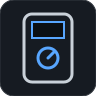 **Qty 1** · **Must meet:** Digital multimeter: DC V, Ω, continuity beep, diode; thermocouple probe (°C)
  - *why:* Every electrical check (T1–T9) and the heat checks · Tool: set `have` if you own one. Link = one cheap example.
  - note:
- [ ] **TLS-06** Digital calipers 150 mm — tool you supply · [buy at sparkfun.com](https://www.sparkfun.com/6-digital-calipers.html) · status: suggested
  -  **Qty 1** · **Must meet:** 150 mm (6 in) digital calipers, 0.01 mm display
  - *why:* Print fit, tolerance coupon, positions · Tool: set `have` if you own one. Link = one cheap example.
  - note:
- [ ] **TLS-07** Tape measure + phone level app — tool you supply · status: suggested
  - 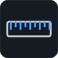 **Qty 1** · **Must meet:** Metric tape ≥ 1 m; any phone level app (replaces a bubble level and set square)
  - *why:* Camera distance, level checks · Tool: set `have` if you own one.
  - note:
- [ ] **TLS-08** Paper printer (100 % scale) — tool you supply · status: suggested
  -  **Qty 1** · **Must meet:** Prints at 100 % scale (or use a print shop)
  - *why:* Placement template, ChArUco boards, focus grid · Tool: set `have` if you own one.
  - note:
- [ ] **TLS-09** CA glue + double-sided tape — tool you supply · status: suggested
  -  **Qty 1** · **Must meet:** Cyanoacrylate (super) glue; double-sided foam or carpet tape
  - *why:* Rim belt (M13.3), protractor scales (M12.3), labels · Consumables: set `have` if in your drawer.
  - note:
- [ ] **TLS-10** 13 mm spanner (or an adjustable wrench) — tool you supply · status: suggested
  -  **Qty 1** · **Must meet:** 13 mm open/ring spanner or an adjustable wrench opening ≥ 13 mm
  - *why:* M8 nuts and bolt heads: table axle, tilt stub axles · Tool: set `have` if you own one.
  - note:

## 01 · Power box

3/12 decided · still to buy $56.84 · [bom.csv](phases/01-power/bom.csv) · [checklist](phases/01-power/README.md)

- [ ] **PWR-01** AC adapter 24 V 2.5 A 60 W — 1 × $19.40 = $19.40 · [buy at mouser.com](https://www.mouser.com/ProductDetail/MEAN-WELL/GST60A24-P1J?qs=odmYgEirbwyH6XaEPxnETQ%3D%3D) · status: suggested
  - 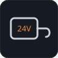 **Qty 1** · **Must meet:** 24 V DC ±5 %, ≥ 2.5 A (60 W), certified (UL/IEC 62368-1), 5.5 × 2.1 mm centre-positive plug
  - *why:* Single certified wall supply · Level VI, UL62368-1, 90.5 %. Plug 5.5/2.1 mm.
  - note:
  - paid:
- [x] **PWR-02** IEC C13 mains cord — 1 × $5.00 = $5.00 · [buy at monoprice.com](https://www.monoprice.com/product?p_id=5279) · status: have
  - 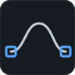 **Qty 1** · **Must meet:** IEC C13 to your wall plug (US: NEMA 5-15P), 18 AWG, ≥ 10 A
  - *why:* Adapter has a C14 inlet; cord sold separately · Consumable: set `have` if it's in your drawer. Any PC cord.
  - note:
  - paid:
- [ ] **PWR-03** DC jack to screw-terminal adapter 2.1 mm — 1 × $2.00 = $2.00 · [buy at adafruit.com](https://www.adafruit.com/product/368) · status: suggested
  -  **Qty 1** · **Must meet:** Female 5.5 × 2.1 mm barrel jack with a 2-screw terminal block marked + / −, centre-positive, ≥ 3 A
  - *why:* Adapter plug in; wires clamp under screws (no solder) · Held in the box-wall slot by the lid. Tighten each screw on twisted, stripped wire.
  - note:
  - paid:
- [ ] **PWR-04** Inline 5 x 20 mm fuse holder — 1 × $3.27 = $3.27 · [buy at mouser.com](https://www.mouser.com/ProductDetail/Littelfuse/01500274ZXU?qs=HS3fcsxbgMwxzHo3fy8LGg%3D%3D) · status: suggested
  -  **Qty 1** · **Must meet:** Inline holder for 5 × 20 mm fuses, ≥ 5 A, with 18 AWG wire leads (no solder: leads go into screw terminals)
  - *why:* Input fuse holder
  - note:
  - paid:
- [ ] **PWR-05** Fuse 3.15 A time-lag 5 x 20 mm — 2 × $0.60 = $1.20 · [buy at mouser.com](https://www.mouser.com/en/ProductDetail/Littelfuse/02183.15MXP?qs=KOeOmFnJLTppf3zFc3qQJA%3D%3D) · status: suggested
  -  **Qty 2** · **Must meet:** 5 × 20 mm glass fuse, 3.15 A, time-lag (T / slow-blow), 250 V
  - *why:* Input over-current protection · One spare.
  - note:
  - paid:
- [ ] **PWR-10** Optocoupler PC817 (DIP-4) — 1 × $0.30 = $0.30 · [buy at digikey.com](https://www.digikey.com/en/products/detail/sharp-socle-technology/PC817X1NSZ0F/2451191) · status: suggested
  -  **Qty 1** · **Must meet:** Optocoupler, DIP-4 (fits a breadboard), current-transfer ratio ≥ 50 % at 2 mA (PC817)
  - *why:* Isolated e-stop sense (plugs into the breadboard) · Isolates 24 V from the laptop.
  - note:
  - paid:
- [x] **PWR-11** Resistors 10k (2) — 1 × $0.40 = $0.40 · [buy at adafruit.com](https://www.adafruit.com/product/2784) · status: have
  -  **Qty 1** · **Must meet:** 10 kΩ, ¼ W, ≤ 5 %, axial (legs push into the breadboard)
  - *why:* Opto LED current (2.3 mA at 24 V); spare · Adafruit 2784: 25-pack (2 used).
  - note:
  - paid:
- [ ] **PWR-13** Emergency stop 22 mm latching, 1 NC — 1 × $9.96 = $9.96 · [buy at tme.com](https://www.tme.com/us/en-us/details/yw1b-v4e01r/panel-mount-switches-standard-22mm/idec/) · status: suggested
  -  **Qty 1** · **Must meet:** 22 mm panel emergency stop, latching (twist to release), ≥ 1 normally-closed contact rated ≥ 24 V DC / 3 A, screw terminals (no solder)
  - *why:* Cuts 24 V to the motion board · Screw terminals: 2 stripped wires may share one screw (twist them together). Also the machine's off switch. Alt: Eaton M22 ~$19.90.
  - note:
  - paid:
- [x] **PWR-15** 18 AWG silicone wire red/black, 1 m pair — 1 × $8.09 = $8.09 · [buy at walmart.com](https://www.walmart.com/ip/2-Conductor-Parallel-Silicone-Wire-18AWG-18-Gauge-Red-Black-Electrical-Wire-Tinned-Copper-1m-3-3ft/2401235173) · status: have
  -  **Qty 1** · **Must meet:** 18 AWG stranded silicone wire, red + black (≥ 5 A)
  - *why:* Power wiring · One pair is enough: red runs box → e-stop → over-travel switch (M4 ring, near 20°) → E4 VIN +; black box → E4 VIN −. Consumable: set `have` if it's in your drawer.
  - note:
  - paid:
- [ ] **PWR-19** Half-size breadboard (400 points) — 1 × $5.00 = $5.00 · [buy at adafruit.com](https://www.adafruit.com/product/64) · status: suggested
  -  **Qty 1** · **Must meet:** Solderless breadboard, ≥ 400 tie points, 2.54 mm, adhesive back
  - *why:* E-stop sense (PC817 + 10k) and lamp driver without solder · Stuck in the controller case. Low-current parts only (≤ 0.5 A); the 24 V motor feed never goes through it.
  - note:
  - paid:
- [ ] **PWR-20** Lever wire connectors, assorted (28) — 1 × $15.71 = $15.71 · [buy at amazon.com](https://www.amazon.com/dp/B01N0LRTXZ) · status: suggested
  - 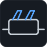 **Qty 1** · **Must meet:** Lever splicing connectors for 24–12 AWG stranded and solid wire, 2/3/5-way, ≥ 20 A (WAGO 221-412/413/415)
  - *why:* Every bare-wire join: no solder, no crimp, no heat-shrink · Strip 11 mm, lift lever, push in, close. Reusable.
  - note:
  - paid:
- [ ] **PWR-18** Power box + lid — print · print · status: suggested
  - 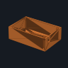 **Qty 1** · **Must meet:** PETG, 0.2 mm layers, 4 walls, 25–30 % infill; settings and checks in this stage's checklist · files: [3d/PWR-18a_power_box.step](phases/01-power/3d/PWR-18a_power_box.step)
  - *why:* Houses power parts; OG-40 mount · ~80 g PETG.
  - note:

## 02 · Controller and buttons

4/11 decided · still to buy $50.70 · [bom.csv](phases/02-controller/bom.csv) · [checklist](phases/02-controller/README.md)

- [ ] **CTL-01** FYSETC E4 (ESP32, 4x TMC2209, WiFi + Bluetooth) — 1 × $32.00 = $32.00 · [buy at fysetc.com](https://www.fysetc.com/products/fysetc-e4-board-with-built-in-wi-fi-and-bluetooth-4-pcs-tmc2209-240mhz-16m-flash-3d-printer-control-board-based-for-3d-printer) · status: suggested
  -  **Qty 1** · **Must meet:** ESP32 board supported by FluidNC with 4 TMC2209 drivers on UART, 12–24 V input, WiFi + Bluetooth (FYSETC E4)
  - *why:* Motion controller running FluidNC; USB / WiFi / BT to the laptop · 12–24 V, CH340 USB. Alts: SKR Pico $39.85, DIY ~$36.
  - note:
  - paid:
- [ ] **CTL-02** Raspberry Pi Pico H (headers soldered) — 1 × $5.00 = $5.00 · [buy at adafruit.com](https://www.adafruit.com/product/5525) · status: suggested
  -  **Qty 1** · **Must meet:** RP2040 Raspberry Pi Pico with factory-soldered 2.54 mm headers (Pico H; Pico WH also fine), runs MicroPython
  - *why:* Buttons, e-stop sense, LED bank · USB-powered. Jumper wires push onto its pins: no soldering.
  - note:
  - paid:
- [x] **CTL-03** USB cable for the E4 (match its port) — 1 × $3.00 = $3.00 · [buy at adafruit.com](https://www.adafruit.com/product/4474) · status: have
  -  **Qty 1** · **Must meet:** USB data cable (not charge-only) with the E4's connector, ≤ 2 m
  - *why:* Laptop to E4 (or use WiFi/BT) · Check your E4's USB port: USB-C → this cable; micro-USB → a second CTL-04.
  - note:
  - paid:
- [x] **CTL-04** USB-A to micro-B data cable 1 m — 1 × $3.00 = $3.00 · [buy at adafruit.com](https://www.adafruit.com/product/592) · status: have
  -  **Qty 1** · **Must meet:** USB-A to micro-B data cable (not charge-only), ≤ 2 m
  - *why:* Laptop to Pico · Consumable: set `have` if it's in your drawer.
  - note:
  - paid:
- [ ] **CTL-05** Membrane keypad 1 x 4 — 2 × $2.95 = $5.90 · [buy at adafruit.com](https://www.adafruit.com/product/1332) · status: suggested
  -  **Qty 2** · **Must meet:** 1 × 4 membrane keypad, 5-wire tail (common + 4 keys) ending in a 2.54 mm female connector, adhesive back
  - *why:* HOME START STOP LIGHT (pad A); NEXT, PAUSE (pad B) · Sticks onto the printed panel. Common → GND, keys → Pico GP2–GP6 with male–female jumpers.
  - note:
  - paid:
- [x] **CTL-06** JST-XH pre-crimped lead kit — 1 × $9.99 = $9.99 · [buy at amazon.com](https://www.amazon.com/Keszoox-Connector-Pre-Crimped-Housing-Socket%EF%BC%8810/dp/B09SX4LC13) · status: have
  -  **Qty 1** · **Must meet:** JST-XH 2.54 mm leads crimped on BOTH ends, ≥ 50 cm, with 2- and 3-pin housings (an XH housing also plugs onto a 2.54 mm pin header)
  - *why:* Keyed connectors · Endstop leads: E4 socket ↔ endstop module pins, no joins. Check the lead length on the listing (≥ 50 cm); price not confirmed.
  - note:
  - paid:
- [x] **CTL-07** Jumper wires male-female 150 mm (20) — 2 × $1.95 = $3.90 · [buy at adafruit.com](https://www.adafruit.com/product/1954) · status: have
  - 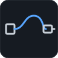 **Qty 2** · **Must meet:** Male–female 2.54 mm jumper wires, ≥ 150 mm, ≥ 20
  - *why:* Keypads, opto and breadboard to the Pico; cut in half for pin-to-wire leads · 2 packs = 40: keypads 7, opto + ground link 3, lamp lead 10 (daisy-chained), sense/HE0/3V3 leads 4, spares. Cut one in half = pin socket on one end, bare wire on the other.
  - note:
  - paid:
- [ ] **CTL-08** Fan 40 mm 24 V — 1 × $4.00 = $4.00 · optional · [buy at amazon.com](https://www.amazon.com/WINSINN-40mm-24V-Fan-Replacement/dp/B07DB5H6K1) · status: suggested
  -  **Qty 1** · **Must meet:** 40 mm fan, 24 V DC, 2-wire
  - *why:* Only if T6 driver temperature fails · Only if the C8 driver temperature check fails.
  - note:
  - paid:
- [ ] **CTL-11** Stepper cable 1 m, PH2.0 6-pin to XH2.54 4-pin (4) — 4 × $1.95 = $7.80 · [buy at jameco.com](https://www.jameco.com/z/JST-PH20-XH4P-Jameco-ValuePro-4-Wire-Stepper-Motor-Cable-4-Pin-Series-PH-2mm-to-6-Pin-XH2-2-54mm-1-Meter_2333607.html) · status: suggested
  -  **Qty 4** · **Must meet:** 1 m, 4-wire, PH2.0 6-pin (motor end) to XH2.54 4-pin (E4 end); check the motor end matches your motor's socket
  - *why:* Motors into the E4 sockets without crimping · The motors' own cables end in a 0.1 in housing that does not seat in the E4's XH sockets. Closeout listing: any PH2.0-6P to XH2.54-4P 1 m cable.
  - note:
  - paid:
- [ ] **CTL-09** Laptop (Windows or Linux) — you supply · status: suggested
  -  **Qty 1** · **Must meet:** Laptop with a free USB port per camera; Windows 10+ (camera via Windows Python) or Linux
  - *why:* Control and processing · No Raspberry Pi needed.
  - note:
- [ ] **CTL-10** Controller case + button panel — print · print · status: suggested
  - 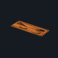 **Qty 1** · **Must meet:** PETG, 0.2 mm layers, 4 walls, 25–30 % infill; settings and checks in this stage's checklist · files: [3d/CTL-10a_button_panel.step](phases/02-controller/3d/CTL-10a_button_panel.step)
  - *why:* Holds E4 and Pico, panel labels
  - note:

## 03 · Frame

1/7 decided · still to buy $49.07 · [bom.csv](phases/03-frame/bom.csv) · [checklist](phases/03-frame/README.md)

- [ ] **FRM-01** Birch plywood 1/2 in, 2 x 2 ft — 1 × $14.00 = $14.00 · [buy at lowes.com](https://www.lowes.com/pd/1-2-in-Birch-Plywood-Application-as-2-x-2/1000066183) · status: suggested
  -  **Qty 1** · **Must meet:** 12 mm (½ in) flat plywood, sold pre-cut at 2 × 2 ft (≈ 610 × 610 mm): used as bought, no saw
  - *why:* Base plate · Price not confirmed. The extra 5 mm per side doesn't matter: everything is placed from the centre.
  - note:
  - paid:
- [ ] **FRM-02** 2020 V-slot 500 mm — 5 × $3.29 = $16.45 · [buy at openbuilds.com](https://us.openbuilds.com/v-slot-20x20-linear-rail/) · status: suggested
  -  **Qty 5** · **Must meet:** 2020 aluminium extrusion, 6 mm slot (V-slot or T-slot), 500 mm, square-cut ends
  - *why:* Outrigger, measuring-camera post, scan-camera post, light-arm upright, horizontal light arm · Five 500 mm pieces: nothing is cut. The upright and arm overhang; that's fine.
  - note:
  - paid:
- [ ] **FRM-03** M5 drop-in T-nut for 2020 — 16 × $0.17 = $2.72 · [buy at kb-3d.com](https://kb-3d.com/store/extrusion-framing/252-t-nut-drop-inroll-in-20-series-6mm-slot-width-m5-threads-1657989339400.html) · status: suggested
  -  **Qty 16** · **Must meet:** M5 drop-in T-nuts for 2020 / 6 mm slot
  - *why:* Brackets on extrusion · 15 used: saddles 4, end foot 1, post sockets 4, arm bracket 1, cross clamp 2, lamp 1, camera plates 2; 1 spare.
  - note:
  - paid:
- [x] **FRM-06** Socket screw assortment M3/M4/M5 — 1 × $12.00 = $12.00 · [buy at amazon.com](https://www.amazon.com/Glarks-510Pcs-Socket-Screws-Assortment/dp/B08HHZHXTP) · status: have
  -  **Qty 1** · **Must meet:** Socket-head M3/M4/M5 screws 8–30 mm with nuts and washers; hex keys 2.5 / 3 / 4 mm included or owned
  - *why:* General fastening · Consumable: set `have` if it's in your drawer. M3 screws self-tap into 2.7 mm printed holes (no inserts). Price not confirmed.
  - note:
  - paid:
- [ ] **FRM-08** 608-2RS bearings (10) — 1 × $9.90 = $9.90 · [buy at walmart.com](https://www.walmart.com/ip/10Pcs-set-608-2RS-Bearing-Deep-Groove-Steel-Sealed-Ball-Bearings-608RS-608-2RS/3999331773) · status: suggested
  -  **Qty 1** · **Must meet:** 608-2RS ball bearings, 8 × 22 × 7 mm, sealed
  - *why:* Table 2, tilt 2, spares 6
  - note:
  - paid:
- [ ] **FRM-12** Wood screws #8 x 5/8 in, Type 17 point (100) — 1 × $6.00 = $6.00 · [buy at fastenersuperstore.com](https://www.fastenersuperstore.com/products/578040/wood-screws) · status: suggested
  -  **Qty 1** · **Must meet:** #8 (4.2 mm) × 5/8 in (16 mm) pan-head wood screws with a Type 17 self-drilling point (start without a pilot hole), Phillips or combo drive
  - *why:* Every printed part, the lazy Susan and the feet onto the plywood: no drilling · 16 mm into 12 mm ply through a ≥ 6 mm printed flange (thin steel plates: add a 4 mm FRM-09g washer): never pokes through.
  - note:
  - paid:
- [ ] **FRM-09** OG-40 adapter, feet, 2020 saddles, post sockets, end foot, protractor scales — print · print · status: suggested
  - 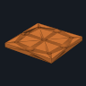 **Qty 1** · **Must meet:** PETG, 0.2 mm layers, 4 walls, 25–30 % infill; settings and checks in this stage's checklist · files: [3d/FRM-09a_og40_adapter.step](phases/03-frame/3d/FRM-09a_og40_adapter.step)
  - *why:* Printed frame parts · Everything screws onto the plywood with FRM-12 wood screws: no drilling. Protractors for alignment [R1].
  - note:

## 04 · Light arm (M4)

0/8 decided · still to buy $41.40 · [bom.csv](phases/04-light-arm/bom.csv) · [checklist](phases/04-light-arm/README.md)

- [ ] **LAR-01** 12 in lazy Susan bearing — 1 × $13.90 = $13.90 · [buy at bearwood.com](https://www.bearwood.com/en-us/products/12-round-lazy-susan-turntable-bearings) · status: suggested
  -  **Qty 1** · **Must meet:** 12 in (≈ 305 mm) lazy-Susan ball bearing, flat, ≥ 50 kg rating, no wobble you can feel
  - *why:* M4: light arm rotates around the sample · Upgrade: VXB aluminium $59.99.
  - note:
  - paid:
- [ ] **LAR-02** NEMA 17 stepper 59 Ncm 2 A — 1 × $9.62 = $9.62 · [buy at omc-stepperonline.com](https://www.omc-stepperonline.com/nema-17-bipolar-59ncm-84oz-in-2a-42x48mm-4-wires-w-1m-cable-connector-17hs19-2004s1) · status: suggested
  -  **Qty 1** · **Must meet:** NEMA 17, 1.8°/step, bipolar 4-wire, ≥ 40 N·cm holding, ≤ 2.0 A/phase (driver runs 0.8 A), 5 mm D-shaft
  - *why:* M4 drive
  - note:
  - paid:
- [ ] **LAR-03** GT2 6 mm open belt (2 m) — 2 × $2.50 = $5.00 · [buy at zyltech.com](https://www.zyltech.com/fiber-glass-reinforced-2gt-gt2-timing-belt-custom-length-price-per-meter/) · status: suggested
  - 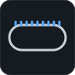 **Qty 2** · **Must meet:** GT2 (2 mm pitch) open belt, 6 mm wide, fibre-reinforced, ≥ 1 m per ring (2 m bought)
  - *why:* Teeth-out around the ring rim (~24:1)
  - note:
  - paid:
- [ ] **LAR-04** GT2 20T pulley 5 mm bore — 1 × $2.95 = $2.95 · [buy at zyltech.com](https://www.zyltech.com/2gt-gt2-6mm-wide-20t-pulley-5mm-6-35mm-or-8mm-bore/) · status: suggested
  -  **Qty 1** · **Must meet:** GT2 (2 mm pitch) 20-tooth, 5 mm bore, for 6 mm belt, 2 set screws
  - *why:* M4 motor pulley · Idlers printed.
  - note:
  - paid:
- [ ] **LAR-05** Optical endstop TCST2103 module — 1 × $2.93 = $2.93 · [buy at ebay.com](https://www.ebay.com/itm/182778778905) · status: suggested
  -  **Qty 1** · **Must meet:** Slotted optical switch module (TCST2103, 3.1 mm slot), 3.3–5 V supply, digital output the E4 home input reads
  - *why:* M4 home
  - note:
  - paid:
- [ ] **LAR-06** Roller-lever limit switch, screw terminals (2) — 1 × $7.00 = $7.00 · [buy at ebay.com](https://www.ebay.com/itm/156727632134) · status: suggested
  -  **Qty 1** · **Must meet:** Roller-lever limit switch with screw terminals (ME-8108 style), normally-closed contact ≥ 3 A at 24 V DC
  - *why:* Over-travel switches in the e-stop loop [R1] · Screw terminals: no solder. One used (red lead passes through COM–NC), one spare.
  - note:
  - paid:
- [ ] **LAR-08** Belt rim segments, M4 motor mount, arm bracket, cross clamp — print · print · status: suggested
  -  **Qty 1** · **Must meet:** PETG, 0.2 mm layers, 4 walls, 25–30 % infill; settings and checks in this stage's checklist · files: [3d/LAR-08a_rim_segment.step](phases/04-light-arm/3d/LAR-08a_rim_segment.step)
  - *why:* Printed M4 parts · Rim segments and the arm bracket bolt to the lazy-Susan top plate with M4 x 12 + nuts (FRM-06) through slots; no idlers: the motor pinion meshes with the rim belt.
  - note:
- [ ] **LAR-09** Laser pointer + small mirror (tool) — you supply · status: suggested
  -  **Qty 1** · **Must meet:** Red laser pointer, class 2 (< 1 mW), plus a small flat mirror
  - *why:* Repeatability test: mirror on the moving part, spot on a wall 2 m away (0.1 deg = 7 mm) · Any pointer; ~$3-5 if bought
  - note:

## 05 · Table (M3)

0/7 decided · still to buy $18.38 · [bom.csv](phases/05-table/bom.csv) · [checklist](phases/05-table/README.md)

- [ ] **TBL-01** NEMA 17 stepper 59 Ncm 2 A — 1 × $9.62 = $9.62 · [buy at omc-stepperonline.com](https://www.omc-stepperonline.com/nema-17-bipolar-59ncm-84oz-in-2a-42x48mm-4-wires-w-1m-cable-connector-17hs19-2004s1) · status: suggested
  -  **Qty 1** · **Must meet:** NEMA 17, 1.8°/step, bipolar 4-wire, ≥ 40 N·cm holding, ≤ 2.0 A/phase (driver runs 0.8 A), 5 mm D-shaft
  - *why:* M3 (table rotation, vertical axis) drive · Same motor on every axis.
  - note:
  - paid:
- [ ] **TBL-02** GT2 6 mm closed belt 232 mm — 1 × $1.88 = $1.88 · [buy at kingroon.com](https://kingroon.com/products/gt2-closed-loop-timing-belt-rubber-2gt-6mm-3d-printers-parts-110-112-122-158-200-280-300-400-610-852-mm-synchronous-belts) · status: suggested
  -  **Qty 1** · **Must meet:** GT2 (2 mm pitch) closed loop, 6 mm wide, 232 mm (116 teeth): puts the motor 49.4 mm from the table axis, inside the lazy Susan opening
  - *why:* 20T to printed 100T, 5:1 · 232 keeps the table motor inside the lazy Susan (ID ~160 mm). 250–260 mm also fits (slide the bracket). Check the length list on the listing.
  - note:
  - paid:
- [ ] **TBL-03** GT2 20T pulley 5 mm bore — 1 × $2.95 = $2.95 · [buy at zyltech.com](https://www.zyltech.com/2gt-gt2-6mm-wide-20t-pulley-5mm-6-35mm-or-8mm-bore/) · status: suggested
  -  **Qty 1** · **Must meet:** GT2 (2 mm pitch) 20-tooth, 5 mm bore, for 6 mm belt, 2 set screws
  - *why:* Motor pulley
  - note:
  - paid:
- [ ] **TBL-04** Optical endstop TCST2103 module — 1 × $2.93 = $2.93 · [buy at ebay.com](https://www.ebay.com/itm/182778778905) · status: suggested
  -  **Qty 1** · **Must meet:** Slotted optical switch module (TCST2103, 3.1 mm slot), 3.3–5 V supply, digital output the E4 home input reads
  - *why:* Home · Price at qty 3.
  - note:
  - paid:
- [ ] **TBL-05** M8 x 75 hex bolt, partial thread + M8 nut (fixed table axle) — 1 × $1.00 = $1.00 · [buy at fastenersuperstore.com](https://www.fastenersuperstore.com/products/276566/hex-cap-screws) · status: suggested
  -  **Qty 1** · **Must meet:** M8-1.25 × 75 mm hex bolt with ≥ 30 mm smooth shank (DIN 931, partial thread), grade 8.8, + M8 hex nut
  - *why:* Fixed axle: head locked in the post, drum turns on two 608s around it · Replaces a cut shaft: no saw, no filed flat.
  - note:
  - paid:
- [ ] **TBL-06** Axis fasteners (M3/M5 set) — $0 (in another row) · [buy at amazon.com](https://www.amazon.com/Glarks-510Pcs-Socket-Screws-Assortment/dp/B08HHZHXTP) · status: suggested
  -  **Qty 1** · **Must meet:** M3/M5 socket screws 8–30 mm, nuts and washers (motor mount, pulley, clamp)
  - *why:* Motor mount, pulley, clamp · Comes from the FRM-06 assortment: nothing extra to buy.
  - note:
  - paid:
- [ ] **TBL-07** Printed table parts — print · print · status: suggested
  - 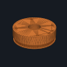 **Qty 1** · **Must meet:** PETG, 0.2 mm layers, 4 walls, 25–30 % infill; settings and checks in this stage's checklist · files: [3d/TBL-07a_table_drum.step](phases/05-table/3d/TBL-07a_table_drum.step)
  - *why:* Post, drum (100T teeth + 608 seats + OG-40 top), motor bracket, flags, spacers
  - note:

## 06 · Camera and light

0/11 decided · still to buy $98.36 · [bom.csv](phases/06-camera-light/bom.csv) · [checklist](phases/06-camera-light/README.md)

- [ ] **CAM-01** USB camera 12 MP IMX477, M12 mount (UVC) — 1 × $59.99 = $59.99 · [buy at arducam.com](https://www.arducam.com/12mp-usb-camera-module-with-m12-lens-1-2-3-3840hx3032v-4k30fps-for-windows-linux-macos-and-android.html) · status: suggested
  -  **Qty 1** · **Must meet:** USB Video Class (UVC) camera, Sony IMX477 12.3 MP, 1.55 µm pixels, M12 × 0.5 lens mount, manual exposure / gain / white balance, ≥ 3840 × 3032 output, IR-cut filter for true colour
  - *why:* Fixed measurement camera on the laptop · Confirm manual white balance (v4l2-ctl -l). Fallback B0446 $54.99.
  - note:
  - paid:
- [ ] **CAM-02** M12 lens 16 mm F2.0, 1/2 in — 1 × $21.00 = $21.00 · [buy at va-imaging.com](https://va-imaging.com/en-us/products/lens-m12-5mp-16mm-f2-0-1-2-va-lm12-5mp-16mm-f2-0-020) · status: suggested
  -  **Qty 1** · **Must meet:** M12 × 0.5 lens, focal length 16 mm (±0.5) → 124 × 98 mm field and 32 µm per pixel at 350 mm, 236 × 186 mm at 650 mm; covers a ≥ 1/2.3 in sensor; F2.0 or slower (used at f/8 via the 2.0 mm stop: 22.6 mm depth of field at 350 mm, 117 mm at 650 mm); distortion < 1 %
  - *why:* Lens · Stock lens focal length unconfirmed.
  - note:
  - paid:
- [ ] **LSR-06** Solderless COB holder, pre-wired (CXA13) — 1 × $3.50 = $3.50 · [buy at mouser.com](https://www.mouser.com/new/molex/molex-slimray-cxa13-led-holders) · status: suggested
  - 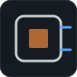 **Qty 1** · **Must meet:** Holder for a 13.35 × 13.35 mm COB (Cree CXA13 family), pre-wired leads ≥ 200 mm or poke-in terminals, rated ≥ 0.5 A
  - *why:* Holds and connects the COB without solder · 180555-0002 = 254 mm red/black leads (-0001 = 110 mm). Leads join the driver wires in a PWR-20 lever connector. Price not confirmed.
  - note:
  - paid:
- [ ] **CAM-07** M2.5 x 8 mm screws (4) — 4 × $0.15 = $0.60 · [buy at sparkfun.com](https://www.sparkfun.com/m2-5-0-45x8mm-machine-screw-phillips-head.html) · status: suggested
  -  **Qty 4** · **Must meet:** M2.5-0.45 × 8 mm pan-head machine screws
  - *why:* Camera board onto its plate (self-tap into 2.2 mm holes) · The FRM-06 kit stops at M3.
  - note:
  - paid:
- [ ] **CAM-08** M2.5 x 20 mm screws (4) — 4 × $0.20 = $0.80 · [buy at fastenersuperstore.com](https://www.fastenersuperstore.com/products/529783/machine-screws) · status: suggested
  -  **Qty 4** · **Must meet:** M2.5-0.45 × 20 mm pan-head machine screws
  - *why:* Camera plate + 15° wedge on the scan post (stage 11; the camera moves there unless you buy CAM-04/05) · Self-tap through the wedge into the camera plate.
  - note:
  - paid:
- [ ] **LSR-01** COB LED CRI 93, 9 V, 400 mA — 1 × $2.66 = $2.66 · [buy at mouser.com](https://www.mouser.com/ProductDetail/Cree-LED/CXA1304-0000-000C0Y9430H?qs=G0uBbFPHMulh2b3olRHR4A%3D%3D) · status: suggested
  -  **Qty 1** · **Must meet:** White chip-on-board LED, Colour Rendering Index (CRI) ≥ 90, 3000–5000 K, ≈ 9 V forward, rated ≥ 350 mA, ≤ 6 mm light-emitting surface
  - *why:* White measurement light · NRND. Better if stocked: Luminus CXM-4-30-95-18.
  - note:
  - paid:
- [ ] **LSR-02** Constant-current driver 350 mA — 1 × $4.81 = $4.81 · [buy at powersupplymall.com](https://powersupplymall.com/products/mean-well-nldd-350h-dc-dc-led-driver-cc-350ma-step-down) · status: suggested
  -  **Qty 1** · **Must meet:** Constant-current LED driver 350 mA, input range covering 24 V, output covering the LED's ≈ 9 V, no flicker (DC output); 2.54 mm-pitch pins that push into a breadboard (or a wire-lead version)
  - *why:* Drives the COB from 24 V; on/off from E4 GPIO2 MOSFET · On/off only, no PWM. Pins push into the PWR-19 breadboard: no solder.
  - note:
  - paid:
- [ ] **LSR-03** Heatsink 40 x 40 mm (from a pack) — 1 × $3.00 = $3.00 · [buy at amazon.com](https://www.amazon.com/Easycargo-40x40x11mm-TEC1-12706-Thermoelectric-40mmx40mmx11mm/dp/B07WR7MPB1) · status: suggested
  -  **Qty 1** · **Must meet:** Aluminium heatsink ≥ 40 × 40 × 11 mm (keeps the LED case ≤ 70 °C)
  - *why:* COB cooling · Price not confirmed. The printed lamp tube clamps holder and heatsink together: no holes to drill in the heatsink.
  - note:
  - paid:
- [ ] **LSR-04** Thermal adhesive pad — 1 × $2.00 = $2.00 · [buy at amazon.com](https://www.amazon.com/HPFIX-Performance-Thermally-Conductive-Durability/dp/B06ZY1JNJV) · status: suggested
  -  **Qty 1** · **Must meet:** Thermally conductive, electrically insulating adhesive tape or pad, ≥ 20 mm wide
  - *why:* COB to heatsink
  - note:
  - paid:
- [ ] **CAM-03** Camera L-arm, aperture stop (f/8), lens lock — print · print · status: suggested
  - 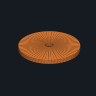 **Qty 1** · **Must meet:** Aperture stop hole = focal length / 8 = 2.0 mm (f/8); matte black PETG so it can't glint · files: [3d/CAM-03a_aperture_stop_f8.step](phases/06-camera-light/3d/CAM-03a_aperture_stop_f8.step)
  - *why:* Fixed, adjustable camera mount · Stop = f/N = 2.0 mm.
  - note:
- [ ] **LSR-05** Lamp body + tube, back cap — print · print · status: suggested
  - 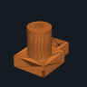 **Qty 1** · **Must meet:** PETG, 0.2 mm layers, 4 walls, 25–30 % infill; settings and checks in this stage's checklist · files: [3d/LSR-05a_lamp_tube.step](phases/06-camera-light/3d/LSR-05a_lamp_tube.step)
  - *why:* Holds heatsink + COB holder, 10 mm exit aperture, polarizer slot, clamps to the horizontal 2020 arm
  - note:

## 07 · Calibrate → game material

0/12 decided · still to buy $33.97 · [bom.csv](phases/07-calibrate/bom.csv) · [checklist](phases/07-calibrate/README.md)

- [ ] **ENC-01** Blackout fabric 54 in (2 yd) — 2 × $6.62 = $13.24 · optional · [buy at walmart.com](https://www.walmart.com/ip/Roc-lon-54-Blackout-White-Fabric-per-Yard/164714653) · status: suggested
  -  **Qty 2** · **Must meet:** Opaque blackout fabric, ≥ 2 yd × 54 in
  - *why:* Light-tight drape · Only if the stray-light test (M21.2) fails in your darkened room. Per yard.
  - note:
  - paid:
- [ ] **ENC-02** Black felt sheet — 1 × $3.00 = $3.00 · [buy at michaels.com](https://www.michaels.com/product/kunin-friendly-black-stiffened-felt-12-sheets-D507116S) · status: suggested
  -  **Qty 1** · **Must meet:** Matte black felt, ≥ 9 × 12 in
  - *why:* Backdrop behind the sample · Upgrade: ENC-05 flocking.
  - note:
  - paid:
- [ ] **ENC-03** Poplar dowel 1/2 in x 36 in — 4 × $2.79 = $11.16 · optional · [buy at truevalue.com](https://www.truevalue.com/product/163701/madison-mill-1-2-in-x-36-in-poplar-dowel-rod-163701/) · status: suggested
  -  **Qty 4** · **Must meet:** ½ in (12.7 mm) hardwood dowels (poplar is fine), 36 in, straight
  - *why:* Drape frame posts · Only with the ENC-01 drape. Any ½ in dowel: oak was $4.04.
  - note:
  - paid:
- [ ] **CAL-01** PTFE sheet 6 x 6 x 0.375 in — 1 × $22.97 = $22.97 · [buy at onlinemetals.com](https://www.onlinemetals.com/en/buy/plastic-sheet-plate-ptfe) · status: suggested
  -  **Qty 1** · **Must meet:** Virgin white PTFE, ≥ 6 mm thick (opaque), ≥ 50 × 50 mm face; sand with 400 grit for a diffuse surface (reflectance ≈ 0.99)
  - *why:* Near-Lambertian white reference · Sand 400 grit.
  - note:
  - paid:
- [ ] **CAL-02** Glass mirror tile ~50 mm — 1 × $3.00 = $3.00 · [buy at amazon.com](https://www.amazon.com/Square-Mirrors-Pieces-Mosaic-Mirror/dp/B01H0ZU1QA) · status: suggested
  -  **Qty 1** · **Must meet:** Flat glass mirror ≈ 50 mm; front-surface preferred (no ghost reflection)
  - *why:* Geometric calibration (specular peak) · Upgrade: Edmund #43-876 $45.75.
  - note:
  - paid:
- [ ] **CAL-03** Chrome steel ball 1 in G25 (2) — 1 × $9.95 = $9.95 · optional · [buy at bcprecision.com](https://www.bcprecision.com/products/1-inch-chrome-steel-ball-bearings-g25) · status: suggested
  -  **Qty 1** · **Must meet:** Two 1 in chrome-steel balls, grade 25 or better (polished)
  - *why:* Optional check of light directions (photometric stereo); light direction already comes from M4 and the mirror test · Not used by any core step. Check qty per price.
  - note:
  - paid:
- [ ] **CAL-04** ChArUco print + picture-frame glass — 1 × $5.00 = $5.00 · [buy at walmart.com](https://www.walmart.com/ip/Mainstays-8x10-Front-Loading-Basic-Tabletop-Picture-Frame-Black/42247821) · status: suggested
  -  **Qty 1** · **Must meet:** ChArUco board 7 × 5, 10 mm squares, 7 mm markers (DICT_4X4_50), laser-printed at 100 % on matte paper, held flat under glass
  - *why:* Intrinsics, pose, repeatability · Board: free generator https://calib.io/pages/camera-calibration-pattern-generator (ChArUco, 7x5, 10 mm), laser print at 100 %; use the frame's glass to hold it flat.
  - note:
  - paid:
- [ ] **CAL-05** Colour target (ColorChecker Mini or similar) — 1 × $74.00 = $74.00 · optional · [buy at bhphotovideo.com](https://www.bhphotovideo.com/c/product/1649333-REG/calibrite_ccc_mini_colorchecker_classic_mini.html) · status: suggested
  -  **Qty 1** · **Must meet:** 24-patch colour checker with published reference values
  - *why:* Colour validation, as in [R1] · Borrow.
  - note:
  - paid:
- [ ] **ENC-05** Flocked light-trap sheet 17.5 x 15 in, self-adhesive — 1 × $7.50 = $7.50 · optional · [buy at fpi-protostar.com](https://www.fpi-protostar.com/hitack.htm) · status: suggested
  -  **Qty 1** · **Must meet:** Flocked light-trap material, self-adhesive, absorbs > 99 %
  - *why:* Line the backdrop and the lamp tube: kills stray reflections · $0.50/in, 15 in minimum. Cheaper: the black felt (ENC-02) plus matte-black filament for parts near the light path.
  - note:
  - paid:
- [ ] **CAL-07** 18 % grey card + white card set (8 x 10 in) — 1 × $10.00 = $10.00 · optional · [buy at neewer.com](https://neewer.com/products/neewer-18-gray-white-card-set-for-white-balance-exposure-value-66600656) · status: suggested
  -  **Qty 1** · **Must meet:** 18 % neutral grey card, matte, ≥ 4 × 5 in
  - *why:* Lock exposure and white balance (M17.5); warm-up target (M18.3) · PTFE (CAL-01) can stand in.
  - note:
  - paid:
- [ ] **ENC-04** Dowel sockets, drape clips — print · print · status: suggested
  - 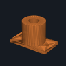 **Qty 1** · **Must meet:** PETG, 0.2 mm layers, 4 walls, 25–30 % infill; settings and checks in this stage's checklist · files: [3d/ENC-04a_dowel_socket.step](phases/07-calibrate/3d/ENC-04a_dowel_socket.step)
  - *why:* Enclosure hardware
  - note:
- [ ] **CAL-06** Kinematic holders for mirror, PTFE, balls — print · print · status: suggested
  - 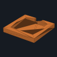 **Qty 1** · **Must meet:** PETG, 0.2 mm layers, 4 walls, 25–30 % infill; settings and checks in this stage's checklist · files: [3d/CAL-06a_ptfe_holder.step](phases/07-calibrate/3d/CAL-06a_ptfe_holder.step)
  - *why:* Fixtures on the stage
  - note:

## 08 · Tilt (M2)

0/7 decided · still to buy $18.88 · [bom.csv](phases/08-tilt/bom.csv) · [checklist](phases/08-tilt/README.md)

- [ ] **TLT-01** NEMA 17 stepper 59 Ncm 2 A — 1 × $9.62 = $9.62 · [buy at omc-stepperonline.com](https://www.omc-stepperonline.com/nema-17-bipolar-59ncm-84oz-in-2a-42x48mm-4-wires-w-1m-cable-connector-17hs19-2004s1) · status: suggested
  -  **Qty 1** · **Must meet:** NEMA 17, 1.8°/step, bipolar 4-wire, ≥ 40 N·cm holding, ≤ 2.0 A/phase (driver runs 0.8 A), 5 mm D-shaft
  - *why:* M2 (sample tilt, horizontal axis) drive · Same motor on every axis.
  - note:
  - paid:
- [ ] **TLT-02** GT2 6 mm closed belt 280 mm — 1 × $1.88 = $1.88 · [buy at kingroon.com](https://kingroon.com/products/gt2-closed-loop-timing-belt-rubber-2gt-6mm-3d-printers-parts-110-112-122-158-200-280-300-400-610-852-mm-synchronous-belts) · status: suggested
  -  **Qty 1** · **Must meet:** GT2 6 mm closed loop, 280 mm
  - *why:* 20T to printed 100T, 5:1 · Length from CAD.
  - note:
  - paid:
- [ ] **TLT-03** GT2 20T pulley 5 mm bore — 1 × $2.95 = $2.95 · [buy at zyltech.com](https://www.zyltech.com/2gt-gt2-6mm-wide-20t-pulley-5mm-6-35mm-or-8mm-bore/) · status: suggested
  -  **Qty 1** · **Must meet:** GT2 (2 mm pitch) 20-tooth, 5 mm bore, for 6 mm belt, 2 set screws
  - *why:* Motor pulley
  - note:
  - paid:
- [ ] **TLT-04** Optical endstop TCST2103 module — 1 × $2.93 = $2.93 · [buy at ebay.com](https://www.ebay.com/itm/182778778905) · status: suggested
  -  **Qty 1** · **Must meet:** Slotted optical switch module (TCST2103, 3.1 mm slot), 3.3–5 V supply, digital output the E4 home input reads
  - *why:* Home · Price at qty 3.
  - note:
  - paid:
- [ ] **TLT-05** M8 x 35 hex bolts, partial thread + nuts (2, tilt stub axles) — 2 × $0.75 = $1.50 · [buy at fastenersuperstore.com](https://www.fastenersuperstore.com/products/276362/hex-cap-screws) · status: suggested
  -  **Qty 2** · **Must meet:** 2 × M8-1.25 × 35 mm hex bolt (DIN 931, smooth shank under the bearing), grade 8.8, + 2 M8 hex nuts
  - *why:* Cradle turns on two stub axles in the yoke's 608s · Nuts sit in hex traps in the cradle.
  - note:
  - paid:
- [ ] **TLT-06** Axis fasteners (M3/M5 set) — $0 (in another row) · [buy at amazon.com](https://www.amazon.com/Glarks-510Pcs-Socket-Screws-Assortment/dp/B08HHZHXTP) · status: suggested
  -  **Qty 1** · **Must meet:** M3/M5 socket screws 8–30 mm, nuts and washers (motor mount, pulley, clamp)
  - *why:* Motor mount, pulley, clamp · Comes from the FRM-06 assortment: nothing extra to buy.
  - note:
  - paid:
- [ ] **TLT-07** Printed tilt parts — print · print · status: suggested
  - 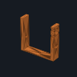 **Qty 1** · **Must meet:** PETG, 0.2 mm layers, 4 walls, 25–30 % infill; settings and checks in this stage's checklist · files: [3d/TLT-07a_tilt_yoke.step](phases/08-tilt/3d/TLT-07a_tilt_yoke.step)
  - *why:* Yoke (motor slots above the axis), 100T pulley, cradle
  - note:

## 09 · Spin (M1)

0/4 decided · still to buy $10.92 · [bom.csv](phases/09-spin/bom.csv) · [checklist](phases/09-spin/README.md)

- [ ] **SPN-01** NEMA 17 pancake stepper 16 Ncm 1 A (direct drive) — 1 × $7.99 = $7.99 · [buy at omc-stepperonline.com](https://www.omc-stepperonline.com/hybrid-stepper-motor/nema-17-bipolar-18deg-13ncm-184ozin-1a-35v-42x42x20mm-4-wires-17hs08-1004s.html) · status: suggested
  -  **Qty 1** · **Must meet:** NEMA 17 pancake, body ≤ 25 mm, 1.8°/step, ≥ 13 N·cm, ≤ 1.0 A, 5 mm D-shaft ≥ 16 mm (driver at 1/64 microstep)
  - *why:* M1 spin: the platter sits on its shaft · Direct drive: no belt, no pulley, no shaft. 400 mm leads: if they end in bare wire, join them to a CTL-11 cable cut in half with lever connectors.
  - note:
  - paid:
- [ ] **SPN-04** Optical endstop TCST2103 module — 1 × $2.93 = $2.93 · [buy at ebay.com](https://www.ebay.com/itm/182778778905) · status: suggested
  -  **Qty 1** · **Must meet:** Slotted optical switch module (TCST2103, 3.1 mm slot), 3.3–5 V supply, digital output the E4 home input reads
  - *why:* Home · Price at qty 3.
  - note:
  - paid:
- [ ] **SPN-06** Axis fasteners (M3/M5 set) — $0 (in another row) · [buy at amazon.com](https://www.amazon.com/Glarks-510Pcs-Socket-Screws-Assortment/dp/B08HHZHXTP) · status: suggested
  -  **Qty 1** · **Must meet:** M3/M5 socket screws 8–30 mm, nuts and washers (motor mount, pulley, clamp)
  - *why:* Motor mount, pulley, clamp · Comes from the FRM-06 assortment: nothing extra to buy.
  - note:
  - paid:
- [ ] **SPN-07** Spin platter (direct drive) — print · print · status: suggested
  - 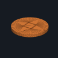 **Qty 1** · **Must meet:** PETG, 0.2 mm layers, 4 walls, 25–30 % infill; settings and checks in this stage's checklist · files: [3d/SPN-07a_spin_platter.step](phases/09-spin/3d/SPN-07a_spin_platter.step)
  - *why:* Sample face; clamps the motor's D-shaft with an M3 grub in a captive nut
  - note:

## 10 · Colour add-ons (optional)

0/9 decided · still to buy $0.00 · [bom.csv](phases/10-color/bom.csv) · [checklist](phases/10-color/README.md)

- [ ] **MSK-01** Narrow-band star LEDs (8 bands, ~420-660 nm) — 8 × $1.50 = $12.00 · optional · [buy at ledsupply.com](https://www.ledsupply.com/leds/luxeon-rebel-color-leds) · status: suggested
  -  **Qty 8** · **Must meet:** 8 narrow-band LEDs on 20 mm stars with pre-soldered wire leads, 1–3 W, bandwidth ≤ 30 nm, spread 420–660 nm
  - *why:* Colour bands · Optional colour kit (stage 10). Luxeon Rebel stars with known wavelengths cost more (~$6–9 each); generic 3 W stars are cheaper but check each wavelength.
  - note:
  - paid:
- [ ] **MSK-02** Constant-current driver 350 mA — 1 × $4.81 = $4.81 · optional · [buy at powersupplymall.com](https://powersupplymall.com/products/mean-well-nldd-350h-dc-dc-led-driver-cc-350ma-step-down) · status: suggested
  -  **Qty 1** · **Must meet:** Constant-current LED driver 350 mA, input covering 24 V
  - *why:* One driver, one LED on at a time · Optional colour kit (stage 10).
  - note:
  - paid:
- [ ] **MSK-03** Darlington array 8-ch — 1 × $0.80 = $0.80 · optional · [buy at adafruit.com](https://www.adafruit.com/product/970) · status: suggested
  -  **Qty 1** · **Must meet:** ULN2803A 8-channel Darlington array (500 mA per channel), DIP-18 (plugs into the breadboard)
  - *why:* Pico selects the band (low-side) · Optional colour kit (stage 10).
  - note:
  - paid:
- [ ] **MSK-04** Heatsink 40 mm (from LSR-03 pack) — 1 × $3.00 = $3.00 · optional · [buy at amazon.com](https://www.amazon.com/Easycargo-40x40x11mm-TEC1-12706-Thermoelectric-40mmx40mmx11mm/dp/B07WR7MPB1) · status: suggested
  -  **Qty 1** · **Must meet:** Aluminium heatsink ≥ 40 × 40 mm
  - *why:* LED bank cooling · Optional colour kit (stage 10).
  - note:
  - paid:
- [ ] **MSK-05** Linear polarizer film 10 x 10 cm (10) — 1 × $8.95 = $8.95 · optional · [buy at walmart.com](https://www.walmart.com/ip/5466199163) · status: suggested
  -  **Qty 1** · **Must meet:** Linear polarizer film for visible light; crossed ÷ parallel ≤ 1/20 when tested
  - *why:* Polarized capture (specular/diffuse separation) · Optional colour kit (stage 10).
  - note:
  - paid:
- [ ] **SPC-01** AS7341 10-band spectral sensor breakout (STEMMA QT) — 1 × $15.95 = $15.95 · optional · [buy at adafruit.com](https://www.adafruit.com/product/4698) · status: suggested
  -  **Qty 1** · **Must meet:** AS7341 10-channel spectral sensor breakout, I²C address 0x39, 3.3 V, STEMMA QT / Qwiic
  - *why:* Spectral reading of the spot at the zero point · I2C 0x39 on Pico GP16/GP17, shared with the OLED
  - note:
  - paid:
- [ ] **SPC-02** JST-SH 4-pin to female jumper cable 150 mm — 1 × $1.00 = $1.00 · optional · [buy at adafruit.com](https://www.adafruit.com/product/4397) · status: suggested
  -  **Qty 1** · **Must meet:** JST-SH 4-pin (STEMMA QT) to female 2.54 mm sockets, ≈ 150 mm
  - *why:* Sensor to Pico
  - note:
  - paid:
- [ ] **MSK-06** LED bank ring on a 40 deg mast, polarizer holders — print · print · status: suggested
  -  **Qty 1** · **Must meet:** PETG, 0.2 mm layers, 4 walls, 25–30 % infill; settings and checks in this stage's checklist · files: [3d/MSK-06a_led_ring.step](phases/10-color/3d/MSK-06a_led_ring.step)
  - *why:* 40° mast: 2nd light height
  - note:
- [ ] **SPC-03** Spectral sensor tube + mount — print · print · status: suggested
  - 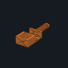 **Qty 1** · **Must meet:** PETG, 0.2 mm layers, 4 walls, 25–30 % infill; settings and checks in this stage's checklist · files: [3d/SPC-03a_spectral_tube.step](phases/10-color/3d/SPC-03a_spectral_tube.step)
  - *why:* 3 mm aperture, ~4 deg field; sits above the camera lens
  - note:

## 11 · 3D scan: capture

1/5 decided · still to buy $3.49 · [bom.csv](phases/11-scan-capture/bom.csv) · [checklist](phases/11-scan-capture/README.md)

- [ ] **SCN-01** Mounting putty 2 oz — 1 × $3.49 = $3.49 · [buy at staples.com](https://www.staples.com/Loctite-Fun-Tak-2-oz-Mounting-Adhesive-Putty-1270884/product_1480018) · status: suggested
  -  **Qty 1** · **Must meet:** Removable mounting putty
  - *why:* Holds objects on the tilted platter during scans · Heavier objects: QuakeHold! $4.99.
  - note:
  - paid:
- [x] **SCN-02** ChArUco scanning mat print — 1 × $1.00 = $1.00 · [buy at calib.io](https://calib.io/pages/camera-calibration-pattern-generator) · status: have
  -  **Qty 1** · **Must meet:** ChArUco mat printed at 100 % on matte paper
  - *why:* Scale and pose check under the object · Free generator: ChArUco, A4/Letter, print at 100 %.
  - note:
  - paid:
- [ ] **CAM-04** Second USB camera 12 MP IMX477, M12 mount (scan camera) — 1 × $59.99 = $59.99 · optional · [buy at arducam.com](https://www.arducam.com/12mp-usb-camera-module-with-m12-lens-1-2-3-3840hx3032v-4k30fps-for-windows-linux-macos-and-android.html) · status: suggested
  -  **Qty 1** · **Must meet:** Identical to CAM-01 (same sensor, so the same settings and calibration steps)
  - *why:* No-switching kit: the scan camera stays at 650 mm; the measuring camera never moves or refocuses · Optional kit: with it the scan camera stays at 650 mm and the measuring camera never moves. Needs 4 × M2.5 × 20 for the wedge.
  - note:
  - paid:
- [ ] **CAM-05** Second M12 lens 16 mm F2.0 (scan camera) — 1 × $21.00 = $21.00 · optional · [buy at va-imaging.com](https://va-imaging.com/en-us/products/lens-m12-5mp-16mm-f2-0-1-2-va-lm12-5mp-16mm-f2-0-020) · status: suggested
  -  **Qty 1** · **Must meet:** Identical to CAM-02: 16 mm focal length (236 × 186 mm field at 650 mm), used at f/8 (2.0 mm stop)
  - *why:* No-switching kit: the scan camera stays at 650 mm; the measuring camera never moves or refocuses
  - note:
  - paid:
- [ ] **SCN-03** Platter risers (20/40/60 mm), 15 deg scan-camera wedge — print · print · status: suggested
  - 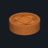 **Qty 1** · **Must meet:** PETG, 0.2 mm layers, 4 walls, 25–30 % infill; settings and checks in this stage's checklist · files: [3d/SCN-03a_riser_20.step](phases/11-scan-capture/3d/SCN-03a_riser_20.step)
  - *why:* Object centre at the zero point · δ = 60 − riser height.
  - note:

## 15 · Standalone (no laptop)

2/8 decided · still to buy $0.00 · [bom.csv](phases/15-standalone/bom.csv) · [checklist](phases/15-standalone/README.md)

- [ ] **STA-01** Raspberry Pi Zero 2 WH (header soldered) — 1 × $18.00 = $18.00 · optional · [buy at adafruit.com](https://www.adafruit.com/product/6008) · status: suggested
  -  **Qty 1** · **Must meet:** Raspberry Pi Zero 2 W with factory-soldered 40-pin header (Zero 2 WH), 64-bit, WiFi
  - *why:* Runs opengonio station: jobs + camera without the laptop · Header pre-soldered: jumpers push on. MSRP; any approved reseller.
  - note:
  - paid:
- [x] **STA-02** microSD card 32 GB — 1 × $6.00 = $6.00 · optional · [buy at adafruit.com](https://www.adafruit.com/product/6010) · status: have
  -  **Qty 1** · **Must meet:** microSD ≥ 16 GB, A1 class
  - *why:* Pi OS + job data · Consumable: set `have` if it's in your drawer.
  - note:
  - paid:
- [ ] **STA-03** Buck converter 24 V to 5 V 3 A — 1 × $3.00 = $3.00 · optional · [buy at amazon.com](https://www.amazon.com/DROK-Display-LM2596-Buck-Converter/dp/B0F6SKTP1P) · status: suggested
  -  **Qty 1** · **Must meet:** Buck converter 24 V in → 5.1 V out, ≥ 3 A, screw terminals on input and output
  - *why:* Powers the Pi from BUS_24V (before the e-stop) · Set to 5.1 V with the multimeter before connecting. Output → Pi 5 V / GND pins through two cut female jumpers.
  - note:
  - paid:
- [ ] **STA-04** Micro-USB OTG adapter — 1 × $2.00 = $2.00 · optional · [buy at adafruit.com](https://www.adafruit.com/product/1099) · status: suggested
  -  **Qty 1** · **Must meet:** Micro-USB OTG to USB-A adapter (powered USB hub if using two cameras)
  - *why:* Camera into the Pi USB port
  - note:
  - paid:
- [ ] **STA-05** SSD1306 OLED 0.96 in I2C 128x64 — 1 × $4.00 = $4.00 · optional · [buy at amazon.com](https://www.amazon.com/HiLetgo-Adafruit-Beaglebones-Raspberry-Optional/dp/B076DYCWC8) · status: suggested
  -  **Qty 1** · **Must meet:** SSD1306 OLED 128 × 64, I²C, 3.3 V, address 0x3C, 4-pin header pre-soldered
  - *why:* Menu and progress on the panel (both modes) · Check the address is 0x3C (some are 0x3D).
  - note:
  - paid:
- [x] **STA-06** Jumper wires female-female (10) — 1 × $2.00 = $2.00 · optional · [buy at adafruit.com](https://www.adafruit.com/product/1950) · status: have
  -  **Qty 1** · **Must meet:** Female–female 2.54 mm jumper wires
  - *why:* Pi UART to Pico; OLED · Consumable: set `have` if it's in your drawer.
  - note:
  - paid:
- [ ] **STA-08** USB-A to micro-B data cable 1 m — 1 × $3.00 = $3.00 · optional · [buy at adafruit.com](https://www.adafruit.com/product/592) · status: suggested
  -  **Qty 1** · **Must meet:** USB-A to micro-B data cable (not charge-only), ≤ 1 m
  - *why:* Pi OTG port to a USB hub / camera
  - note:
  - paid:
- [ ] **STA-07** Pi Zero mount + OLED window — print · print · status: suggested
  - 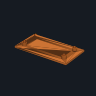 **Qty 1** · **Must meet:** PETG, 0.2 mm layers, 4 walls, 25–30 % infill; settings and checks in this stage's checklist · files: [3d/STA-07a_pi_zero_mount.step](phases/15-standalone/3d/STA-07a_pi_zero_mount.step)
  - *why:* Clips into the controller case
  - note:
