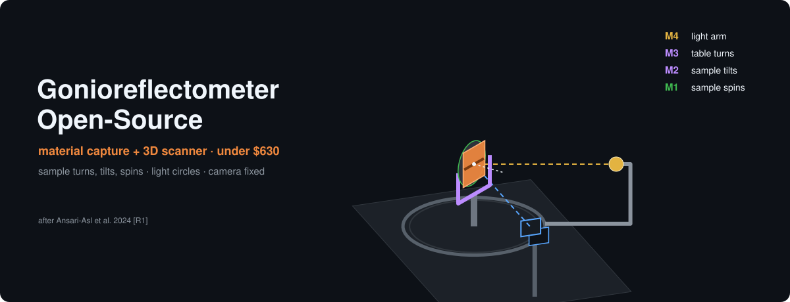
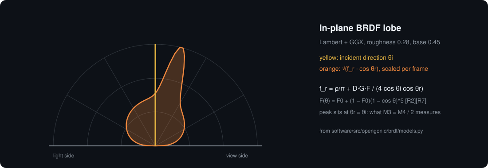

# Gonioreflectometer-Open-Source

**OpenGonio** — a low-cost, open-source version of the multispectral material-appearance device of Ansari-Asl et al. (*J. Imaging*, 2024) [R1]: fixed camera, 3-axis sample stage, rotating light arm. Your laptop controls it (USB, WiFi or Bluetooth) and processes the data; physical buttons run the main actions.

| | |
|---|---|
| **Measures** | BRDF → isotropic → anisotropic → SVBRDF / BTF → multispectral |
| **Scans** | 3D objects up to ~110 mm: photogrammetry with known poses, visual hull, photometric stereo → PLY / OBJ / glTF |
| **Precision** | ≤ 0.028° per microstep on every axis, optical homing, 0.1° repeatability target |
| **Cost** | $498.95 buy-everything, $443.27 if you own the consumables (cheapest parts by default) |
| **Interactive site** | [`docs/index.html`](docs/index.html) — machine simulator, BRDF explorer, scan planner, equations |

## How it works





## Build plan



Each phase is a GitHub milestone with checklist issues → [`ROADMAP.md`](ROADMAP.md).



## Docs

| | |
|---|---|
| [Architecture](docs/architecture.md) | axes, frame, control paths, pin maps, drill map |
| [Theory](docs/theory.md) | every CS348b equation [R2] + device equations [R1] |
| [3D scanner](docs/scanner.md) | scan mode, methods, equations, commands |
| [Budget](docs/budget.md) · [BOM](bom/master_bom.csv) | cheapest choices, caps, every price with a reference |
| [Power](docs/power.md) | requirement table, 60 W budget |
| [Modules](hardware/) | power, controller, scan kit detailed; others scoped |
| [Firmware](firmware/README.md) | FluidNC (E4) + MicroPython (Pico) |
| [Safety](docs/safety.md) · [Licensing](docs/licensing.md) · [Onshape](docs/onshape.md) | |
| [References](REFERENCES.md) | every source used, with IDs |
| [Publish](PUBLISH.md) | copy-paste commands for a private GitHub repo |

## Quick start (no hardware)

```bash
cd software && python3 -m venv .venv && . .venv/bin/activate && pip install -e ".[dev]"
python -m pytest -q
opengonio check-pose M4=60 M3=30          # angles + collision check → specular
opengonio --dry-run move M4=80 M3=25      # prints FluidNC G-code
opengonio scan demo --out demo            # synthetic 3D scan: visual hull PLY + photometric stereo
```

## Credits

Design reference: M. Ansari-Asl, M. Barbieri, G. Obein, J. Y. Hardeberg, *J. Imaging* 10(3):55, 2024, [doi:10.3390/jimaging10030055](https://doi.org/10.3390/jimaging10030055). Theory: P. Hanrahan, Stanford CS348b. Firmware: [FluidNC](http://wiki.fluidnc.com/), [MicroPython](https://docs.micropython.org/). Full list: [REFERENCES.md](REFERENCES.md). All figures are original drawings.

Hardware CERN-OHL-S-2.0 · software GPL-3.0-or-later · docs CC BY-SA 4.0.
