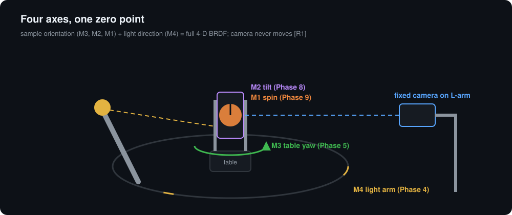
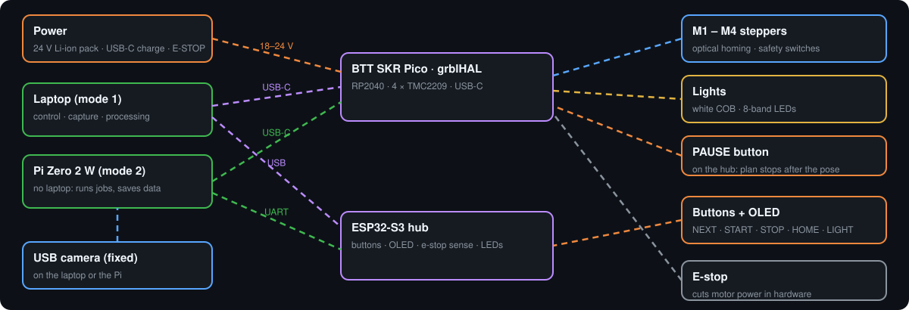

# Architecture

Low-cost version of the device in Ansari-Asl et al. 2024 [R1]: **camera fixed, sample rotates on three axes, light rotates on an arm**, all meeting at one zero point. Laptop does control and processing.

## Axes

| Axis | Motion | Range | Drive | Resolution | Phase |
|---|---|---|---|---|---|
| M4 | Light arm on a 12 in ring, about +Z | 20–340° from the camera | GT2 around ring, ~24:1 | 0.0047° | 1 |
| M3 | Table yaw, about +Z (0 = sample faces camera) | ±180° | 20T→100T, 5:1 | 0.0225° | 1 |
| M2 | Sample tilt, horizontal axis | ±90° | 5:1 | 0.0225° | 3 |
| M1 | Sample spin, about its normal | ±180° | 20T→80T, 4:1 | 0.028° | 4 |

Homing: optical barrier per axis (as [R1]). Over-travel: roller-lever switches in series with the e-stop (as [R1]). Software: keep-out + minimum light/camera angle (as [R1]), see `software/src/opengonio/gantry/collision.py`.

## Coordinate frame

Origin = zero point (sample surface). +Z up. Camera on +X at 350 mm, elevation fixed (default 0°). Light at 300 mm. Sample rotation $R = R_z(M_3)R_y(-M_2)R_x(M_1)$ — equations in [`theory.md`](theory.md).

## Control

| Path | How |
|---|---|
| Laptop → motion | FluidNC on the FYSETC E4 over USB serial, WiFi (telnet :23) or Bluetooth serial [R24][R30] |
| Laptop → camera | USB UVC, manual exposure/gain/WB [R47][R50] |
| Scan mode | camera at 650 mm; object on M1/M2; poses from kinematics → COLMAP [S1][S2] |
| Buttons → actions | HOME, START, STOP, LIGHT, NEXT on the Pico hub → `opengonio panel` |
| Without laptop | PAUSE on the E4 feed-hold pin [R27]; jog/home from the FluidNC WebUI on a phone (WiFi build) |
| Stop | E-STOP (and over-travel switches) cut 24 V to the E4. Pico senses it; on release the software re-initialises the drivers (`$MI`) and forces re-homing |

## Interfaces (frozen at M0)

**OG-40 pattern:** 4 × M4 on a 40 × 40 mm square, Ø6.2 locating hole. M4 tee nuts in wood, heat-set inserts in prints.

**Base drill map** (600 × 600 mm plywood, origin under the zero point):

| Feature | Position (mm) | Holes |
|---|---|---|
| Table post | (0, 0) | OG-40 |
| Ring sub-plate | 4 × on Ø250 at 45°/135°/225°/315° | M5 tee nuts |
| Camera outrigger (2020, 500 mm) | along +X from (200, 0) | 2 × M5 into the base |
| Camera post | (380, 0) on the outrigger (BRDF, 350 mm); slides to (680, 0) for scanning (650 mm stop) | 2 × M5 T-nuts |
| Outrigger end foot | (700, 0) | printed |
| Power box | (−220, −220) | OG-40 |
| Controller + panel | (−220, 220) | OG-40 |
| Feet | 30 mm from each corner | M8 tee nuts |

Boxes stay below the light arm (arm height = zero point, 150 mm above the base).

**Connectors:** JST-XH inside modules; XT30 for 24 V; sources carry the female XT30.

| Code | Connector | Pins |
|---|---|---|
| J1 | Switchcraft 721A panel jack | centre +24 V, sleeve GND |
| J2 | XT30 | +24 V MOTION (after e-stop), GND |
| J3 | JST-XH 2 | over-travel roller switches, NC, in series with the e-stop |
| J4 PWR-SIG | JST-XH 2 | isolated sense: 1 PC817 collector → Pico GP7, 2 emitter → Pico GND |
| M-x | JST-XH 4 (E4 side) | motor A+, A−, B+, B− |
| E-x | JST-XH 3 | +3V3/5V, GND, SIGNAL (TCST2103) |
| L-WHITE / L-MS | JST-XH 2 | driver +Vin, switched − (E4 GPIO2 / GPIO4 MOSFET) |
| BTN | JST-XH 6 | HOME, START, STOP, LIGHT, NEXT, GND |

## Pin maps

**FYSETC E4** (from [C1]; verify on the schematic):

| Function | GPIO |
|---|---|
| M4 / X step, dir | 27, 26 |
| M3 / Y step, dir | 33, 32 |
| M2 / Z step, dir | 14, 12 |
| M1 / A (E0) step, dir | 16, 17 |
| Shared enable | 25 |
| TMC UART TX, RX | 22, 21 (addr X1 Y3 Z0 E2 [R33][R35]) |
| Home M4, M3, M2 | 34, 35, 15 (endstop inputs) |
| Home M1 | 36 (TH0 input) |
| PAUSE (feed hold) | 39 (TH1 input) |
| White light, LED bank, fan | 2, 4, 13 (MOSFET outputs, `M62/M63 P0/P1/P2`) |

**Pico hub** (`firmware/pico-hub/main.py`):

| Function | GP |
|---|---|
| HOME, START, STOP, LIGHT, NEXT (to GND) | 2, 3, 4, 5, 6 |
| MOTION_SENSE (from J4, active low, pull-up) | 7 |
| LED bank 1–8 → ULN2803A (Phase 5) | 8–15 |
| Optional AS5600 SoftI2C (SCL, SDA) | (17,16), (19,18), (21,20), (27,26) |
