# Budget

Cheapest credible part is the default on every line. Generated numbers: [`../bom/summary.md`](../bom/summary.md). USD, approximate, before tax and shipping; each price carries its check date and reference ID in `bom/master_bom.csv`.

| | Buy everything | Already own wire, screws, cords, inserts, JST kit |
|---|---:|---:|
| Phase 1 | $346.82 | $292.14 |
| All phases | **$498.95** | **$443.27** |
| vs $500 hard cap | $1.05 under | $56.73 under |

Buy-everything is only $1.05 under the cap: any price rise breaks it, so check prices again before ordering. Owned consumables give real margin.

## Caps

Brief phases map to this build as: 1→1, 2→2, 3→3, 4→4, scanner 5→**6**, on-object 6→**7**. Phase 5 (multispectral, after [R1]) is new and uses the $15 contingency. Fixed camera [R1] moves cost into Phase 1 (ring + table), and the scanner reuses Phases 1–5, so it needs only $4.49.

| Phase | Brief | Proposed | Buy all |
|---|---:|---:|---:|
| 1 In-plane BRDF | $300 | $347 | $346.82 |
| 2 Calibrated | $75 | $73.50 | $73.32 |
| 3 Isotropic (+M2) | $45 | $22.50 | $22.38 |
| 4 Anisotropic (+M1) | $35 | $22.50 | $22.38 |
| 5 Multispectral | — | $30 | $29.56 |
| 6 3D photo scanner | $30 | $4.50 | $4.49 |
| 7 On-object appearance | $0 | $0 | $0 |
| **Total** | **$485 + $15** | **$500** | **$498.95** |

## Where the money goes and why

| Choice | Cheapest option chosen | Rejected (and why) |
|---|---|---|
| Compute | Your laptop ($0) | Raspberry Pi 5 ($110–175 [R63]) |
| Motion | FYSETC E4, $32: 4 × TMC2209, WiFi, BT, USB [C3] | SKR Pico $39.85 [R56], DIY ESP32 + 4 modules ~$36 [R68][R69], SKR Mini E3 $49.85 [R64] |
| Power | GST60A24 60 W, $19.40 [P1] (114 % headroom) | 120 W adapter + 5 V buck ($85, only needed for a Pi) [P31][P32] |
| Camera | Arducam B0433 IMX477 USB + 16 mm lens, $80.99 [K1][K5] | Pi HQ camera (needs a Pi) [K19]; ESP32-S3 cameras (autofocus) [R79][R80] |
| White light | Cree CXA1304 CRI 93, $2.66 + NLDD-350H $4.81 [L1][L4] | 36 V COBs need a 48 V supply [L9][L18] |
| E-stop | IDEC YW1B, $9.96 (3 A+ DC rated) [P15] | Schneider XB5 (0.5 A DC) [P23], Eaton $19.90 [P17] |
| Mirror | Craft glass mirror tile, ~$3 | Edmund first-surface $45.75 [E5] (upgrade later) |
| Multispectral | 8 narrow-band LEDs + 1 driver + ULN2803A, ~$17 | Filter cameras of [R1] (lab-grade cost) |
| Scanner | Reuses camera, axes, lights; adds putty $3.49 [S20] + printed risers | Separate turntable scanner; RealityScan is free for students [S18] but optional |
| TVS diode | Littelfuse P6KE30A $0.14 [P10] | ST P6KE30A $0.94 |

**Estimates:** $118.89 of the total is still "estimate (not checked)" (wire, screws, fuses, cords, LEDs). They are marked in the CSV and get real prices when each module starts.
