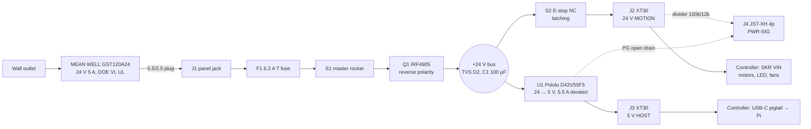

# Power module (Phase 1, M1.1)

One certified wall adapter in, three protected low-voltage outputs out, sized for the **finished
four-axis machine** from day one. Status: **design complete, awaiting build and acceptance test.**

> Licence: hardware CERN-OHL-S-2.0 · this document CC BY-SA 4.0 · prices approximate, checked 2026-10-04.

---

## 1. Purpose, interface spec, and what attaches later

**Purpose.** Turn 120 V/230 V mains into 24 V and 5 V for the whole machine **without any exposed
mains wiring**: mains stays inside a UL-listed, DOE Level VI desktop adapter. The module adds an input
fuse, reverse-polarity protection, a master switch, a latching e-stop that removes power from the
motion board only, and two status signals for the Pi.

**Design numbers (final machine, from [`docs/02-power-budget.md`](../../docs/02-power-budget.md)):**

| | Typical | Peak (allocation) | Sleep |
|---|---:|---:|---:|
| Adapter DC output | 22.7 W (0.95 A) | 74.4 W (3.10 A) | 4.3 W |
| Wall plug | 25.8 W | 82.2 W | 5.8 W |
| Headroom on the 120 W adapter | | **61 %** above peak (120 / 74.4 − 1; 38 % of capacity unused) — ≥ 25 % required | |

### Block diagram



### Connectors (published pinout; power sources always carry the **female** XT30)

| Ref | Connector on the box | Pin | Signal | Wire | Limit |
|---|---|---|---|---|---|
| J1 | PJ-005B panel jack (2.5 mm pin) | centre / sleeve | +24 V in / GND | adapter cord | 5 A |
| J2 | XT30U **female** | + / − | 24 V MOTION (after e-stop) / GND | 18 AWG | 5 A (fuse 6.3 A) |
| J3 | XT30U **female** | + / − | 5 V HOST / GND | 18 AWG | 5.5 A |
| J4 | JST-XH 4-pin header | 1 | MOTION_SENSE: 0 V or 2.57 V (24 V × 12k/112k, 10 k series, BAT85 clamps) | 24 AWG | 3.3 V logic |
| | | 2 | BUCK_PG: open drain, high = 5 V in regulation | | |
| | | 3 | +3V3 from the Pi (pull-up supply only) | | < 1 mA |
| | | 4 | GND | | |
| J5 | Knock-out only (reserved) | + / − | future 24 V AUX, unswitched | — | — |

Mechanical interface: the box bolts to the front-right corner of the base plate through the
**OG-40 pattern** (4 × M4 on a 40 × 40 mm square, see [`docs/03-architecture-interfaces.md`](../../docs/03-architecture-interfaces.md)).

### What later phases attach (no redesign)

| Phase | Load added | Comes from |
|---|---|---|
| 1 | A1 + A2 steppers, main light, controller fan | J2 via SKR |
| 3 | A3 ring stepper | J2 via SKR (Z driver) |
| 4 | A4 turntable stepper | J2 via SKR (E0 driver) |
| 5 | Polarizer servo (5 V) | J3, tapped in the controller box |
| 5 | Fill light (second COB + NLDD) | J2 via SKR FAN2 |

Everything above is already counted in the power budget.

---

## 2. Bill of materials

Source of truth: [`bom/modules/power.csv`](../../bom/modules/power.csv) (generated from
`bom/master_bom.csv`). Module subtotal: **$128.07 spec / $115.99 budget / $106.39 with own
stock** — 43 % / 39 % / 35 % of the $300 Phase 1 cap.

| ID | Part | Qty | Unit (USD) | Supplier | STEP / model |
|---|---|---:|---:|---|---|
| PWR-01 | MEAN WELL GST120A24-P1M 24 V 5 A | 1 | 44.70 | [Mouser](https://www.mouser.com/en/ProductDetail/MEAN-WELL/GST120A24-P1M?qs=V113mesSgrhUmhAWUz3R2A%3D%3D) | Seen on the Mouser page (STP zip), not downloaded. Envelope 167 × 67 × 35 mm. [Datasheet](https://www.meanwell.com/Upload/PDF/GST120A/GST120A-SPEC.PDF) |
| PWR-02 | Pololu D42V55F5 (5 V, 6 A) | 1 | 39.95 | [Pololu](https://www.pololu.com/product/5571) | Not listed for this part. Same-size D36V50Fx STEP: [confirmed](https://www.pololu.com/file/0J1733/d36v50fx-step-down-voltage-regulator.step) — use it as the envelope, 25.4 × 25.4 × 9 mm, 3 × M2 |
| PWR-03 | Same Sky PJ-005B jack | 1 | 3.36 | [Digi-Key](https://www.digikey.com/en/products/detail/same-sky-formerly-cui-devices/PJ-005B/172263) | **None exists.** Model from [datasheet](https://www.sameskydevices.com/product/resource/pj-005b.pdf): body 21.2 × 10.8 × 10.8 mm, threaded bushing |
| PWR-04 | Littelfuse 03455LS1H fuse holder | 1 | 6.44 | [Newark](https://www.newark.com/littelfuse/03455ls1h/fuse-holder-5-x-20mm-panel-mount/dp/67K0280) | Not confirmed. [Datasheet](https://www.farnell.com/datasheets/3708377.pdf) |
| PWR-05 | Littelfuse 021806.3MXP 6.3 A T | 1 | 1.64 | [Newark](https://www.newark.com/littelfuse/021806-3mxp/fuse-cartridge-6-3a-5x20mm-slow/dp/42K9390) | n/a |
| PWR-06 | Infineon IRF4905PBF | 1 | 2.73 | [Mouser](https://www.mouser.com/ProductDetail/Infineon-Technologies/IRF4905PBF?qs=9%2BKlkBgLFf39l0HsWdxvdw%3D%3D) | Standard TO-220 model. [Datasheet](https://www.infineon.com/dgdl/irf4905pbf.pdf?fileId=5546d462533600a4015355e329b1197e) |
| PWR-07 | 1N4742A 12 V zener + 10 k | 1 | 0.50 est. | Digi-Key | standard |
| PWR-08 | P6KE30A TVS | 1 | 0.60 est. | Digi-Key | standard |
| PWR-09 | Bulgin C1353ABNAB rocker (10 A DC) | 1 | 3.00 est. | [Digi-Key](https://www.digikey.com/en/products/detail/bulgin/C1353ABNAB/9598373) | Not confirmed — measure the snap-in cutout from its datasheet |
| PWR-10 | IDEC YW1B-V4E01R e-stop | 1 | 9.96 | [TME](https://www.tme.com/us/en-us/details/yw1b-v4e01r/panel-mount-switches-standard-22mm/idec/) | Not confirmed. 22.3 mm hole, 40 mm head. [Datasheet](https://mm.digikey.com/Volume0/opasdata/d220001/medias/docus/6163/D004450YWapem.pdf) |
| PWR-11 | Resistors 100k, 12k, 10k, 100k, 1k + 2 × BAT85 Schottky | 1 set | 0.60 est. | Digi-Key | standard |
| PWR-12 | AMASS XT30U pairs (5) | 1 | 2.19 | [rcbattery](https://rcbattery.com/genuine-amass-xt30u-male-female-pair-plugs-5-pairs.html) | Community STEP (PCB version, no licence stated, link only): [realthunder](https://github.com/realthunder/Connectors_Amass.3dshapes) |
| PWR-13 | 18 AWG silicone wire, red + black | 1 | 8.00 est. | any | — |
| PWR-14 | Perfboard 50 × 70 mm | 1 | 1.00 est. | any | plate model |
| PWR-15 | USB-C power plug pigtail, **≥ 20 AWG, rated 5 A** (cheap 24–28 AWG pigtails overheat) | 1 | 3.00 est. | any | envelope only |
| PWR-18 | 100 µF 50 V electrolytic | 1 | 0.40 est. | Digi-Key | standard |
| PWR-16 | Printed enclosure (PETG, ~90 g) | 1 | 0 | print | this project |
| PWR-17 | Plug-in wattmeter | — | borrow | — | optional |

"est." = estimate, price not checked on 2026-10-04. Vendor CAD is **linked, never committed**
(see [`docs/06-licensing.md`](../../docs/06-licensing.md)).

**Why these parts**

- **Adapter.** GST120A24 is Level VI, UL62368-1, 90.5–91 % typical, < 0.15 W no-load, and its P1M
  plug is rated for the full 5 A. Its plug is **5.5/2.5 mm**, so the panel jack must have a 2.5 mm pin.
- **Buck.** The brief asks for ≥ 90 % at our load from a real datasheet. Pololu publishes 80–95 %
  but the 24 V curve could not be read on the check date, so **efficiency is a test item (T5), not
  an assumption.** D42V55F5 over D36V50F5: same price, ±3 % instead of ±4 %, 6 A, built-in
  reverse-voltage protection and a power-good pin. No 5.1 V version exists in this class; 5.0 V ±3 %
  feeds the Pi through 25 cm of 18 AWG (≈ 32 mV drop at 3 A, both conductors), which T4 verifies.
  The D24V50F5 budget option has **no PG pin**: on that path tie J4 pin 2 high through R5 so
  `rail_5v_good` always reads true (the software keeps working, the check is lost).
- **E-stop.** Rated 8 A resistive / 4 A inductive at 24 V DC; the final machine's 24 V direct peak is
  40.8 W ≈ 1.7 A (power budget), so it switches the load directly — the simplest fail-safe.
  Confirm the 8 A / 4 A DC figures in the YW datasheet when you order.

---

## 3. Onshape modelling (custom parts)

Part Studio **`PWR – Power box`** in the project document, driven by the shared Variable Studio
**`OG globals`**. Name every variable exactly as below so other modules can reference them.

### Variables

| Variable | Default | Meaning |
|---|---:|---|
| `#clear` | 0.25 mm | printer fit clearance per side (tune with the tolerance coupon) |
| `#wall` / `#floor` / `#lid_t` | 3.2 / 3.0 / 3.0 mm | 4 perimeters at 0.4 mm nozzle |
| `#box_l` × `#box_w` × `#box_h` | 140 × 90 × 55 mm | outside size |
| `#corner_r` | 6 mm | outside corner radius |
| `#ins_m3_d` / `#ins_m3_depth` | 4.0 / 6.0 mm | M3 heat-set insert hole |
| `#og40` / `#m4_clear` | 40 / 4.5 mm | OG-40 bolt square and clearance |
| `#estop_d` | 22.3 mm | IDEC YW 22 mm hole (verify panel-thickness range in the datasheet) |
| `#jack_d` | 8.2 mm | PJ-005B bushing — **measure / confirm in datasheet before printing** |
| `#fuse_d` | 12.5 mm | 03455LS1H bushing — **confirm in datasheet** |
| `#rocker_w` × `#rocker_h` | 19.2 × 12.9 mm | C1353 snap-in cutout — **confirm in datasheet** |
| `#xt30_w` × `#xt30_h` | 10.4 × 5.4 mm | XT30U body slot + `#clear` |
| `#vent_w` / `#vent_pitch` | 2.0 / 4.0 mm | side vent slots over the buck |

### Features (in order)

1. **Sketch `outline`** (Top plane): centred rectangle `#box_l × #box_w`, corner fillets `#corner_r`.
2. **Extrude** `#box_h` → **Shell** (remove top face), thickness `#wall`.
3. **Corner posts**: 4 × Ø9 cylinders full height in the inside corners, each with an
   `#ins_m3_d × #ins_m3_depth` hole from the top (lid screws).
4. **Floor bosses**:
   - Perfboard: 4 × Ø7 × 6 mm bosses with insert holes; place them from the measured board holes
     (`#pcb_hole_x`, `#pcb_hole_y`).
   - Buck: import Pololu's drill DXF (`https://www.pololu.com/file/0J1734/` from the D36V50Fx
     resources, same pattern) into a floor sketch; 3 × Ø5 × 5 mm bosses, M2 self-tapping pilot 1.7 mm.
     Put the buck under the vent slots, 10 mm from any wall.
   - IRF4905: a 10 mm boss with an M3 insert so the tab bolts down flat (the tab is the drain,
     **live at +24 V**: use a nylon washer if the boss ever becomes metal).
5. **OG-40 floor holes**: 4 × `#m4_clear` on a `#og40` square, counterbored Ø8 × 3 mm from inside.
6. **Front face** (−Y): rocker cutout and fuse-holder hole, 25 mm apart, centred 30 mm above the floor.
7. **Rear face** (+Y): jack hole, two XT30 slots (labels `24V MOTION`, `5V HOST`), a 13 × 6 mm
   slot for the J4 lead, and a 0.6 mm-thick **knock-out** plate for J5.
8. **Lid**: new sketch on the top face offset; lid plate `#lid_t`, 2 mm locating lip inset by
   `#wall + #clear`, 4 × M3 counterbored holes on the post centres, **`#estop_d` hole centred**,
   with a 3.5 mm anti-rotation notch where the IDEC ring expects it.
9. **Vents**: 6 slots `#vent_w` wide at `#vent_pitch` on both side walls above the buck.
10. **Text**: embossed 0.6 mm labels — `24V MOTION`, `5V HOST`, `+ CENTRE`, `MAX 24 V`.
11. Insert the purchased-part envelopes (PJ-005B block, D36V50Fx STEP, e-stop cylinder Ø40 head)
    in an Assembly **`PWR – Power module`** and check clearances with **Interference**.

### Print settings

| Part | Material | Orientation | Layer | Walls | Infill | Supports |
|---|---|---|---|---|---|---|
| Box | PETG | open side up | 0.2 mm | 4 | 25 % gyroid | none (round holes on walls print without; add a teardrop to `#estop_d` if your printer sags) |
| Lid | PETG | top face on the bed | 0.2 mm | 4 | 25 % | none |

Heat-set inserts at about 245 °C. Export each part as **STEP** (`hardware/power/cad/`) and
**3MF** (`hardware/power/print/`).

---

## 4. Assembly

**Tools:** soldering iron (350 °C for 18 AWG and XT30), multimeter, heat-shrink, 2.5 mm and 3 mm hex keys,
wire strippers, insert tip for the iron.

1. **Inserts.** Press all M3 heat-set inserts into the box posts and bosses. Let them cool before loading.
2. **Panel parts.** Fit the rocker (snap in), fuse holder (nut finger-tight + ⅛ turn), PJ-005B
   (nut finger-tight + ⅛ turn; it must not spin), and the e-stop in the lid (ring nut hand-tight with the
   anti-rotation tab engaged).
3. **Protection board** (perfboard, see §5):
   - IRF4905 pin order is G-D-S (left to right, legs down, text facing you). **Drain** goes to the
     input side, **source** to the +24 V bus.
   - Zener: **cathode (band) to source**, anode to gate. 10 k from gate to GND.
   - P6KE30A: band to +24 V bus, other end to GND. 100 µF: + to bus, − to GND, close to the buck input.
   - Divider: 100 k (R2) from the J2 + pin to the SENSE node, 12 k (R3) from SENSE to GND,
     10 k (R4) from SENSE to J4 pin 1. Clamp J4 pin 1 with two BAT85: one from pin 1 to J4 pin 3
     (band toward pin 3), one from GND to pin 1 (band toward pin 1). Even with R2/R3 swapped the Pi pin
     then sees ≤ 3.6 V and < 2 mA.
   - R5 100 k: **one end on the buck PG pin, the other end on J4 pin 3** (a pull-up, not in series);
     PG also wires straight to J4 pin 2.
4. **Main path in 18 AWG:** J1 centre → F1 → S1 → Q1 drain. Q1 source → bus. Bus → e-stop NC terminal
   → J2 +. Bus → buck VIN. Buck VOUT → J3 +. All GNDs to one star point on the perfboard. Keep the
   e-stop leads long enough to lift the lid (service loop, 120 mm).
5. **XT30s:** tin and solder, heat-shrink each joint. Press them into the rear slots with a drop of
   CA glue. Female on the box (live pins shrouded).
6. **Bolt down** the buck (M2 self-tappers, snug — do not crack the board) and Q1 (M3 × 8, 0.5 N·m).
7. **Close** the lid with 4 × M3 × 10 into the inserts, 0.5 N·m.
8. **Mount** the box on the base: 4 × M4 × 12 into the OG-40 tee nuts, 1.2 N·m.
9. **Cables to the controller:** 18 AWG XT30 male–male leads, J2 → SKR VIN (observe SKR polarity
   silkscreen), J3 → controller box → USB-C pigtail → Pi. J4 → 4-pin JST-XH → Pi header (§5).
10. **Before connecting anything:** run tests T1–T3 with the outputs unplugged.

---

## 5. Wiring diagram and pinout

The block diagram in §1 shows the flow; wire from this netlist (every connection appears once).

| Net | Members (every pin on the net) | Wire |
|---|---|---|
| `VIN_RAW` | J1 centre pin, F1 terminal A | 18 AWG red |
| `VIN_FUSED` | F1 terminal B, S1 common | 18 AWG red |
| `VIN_SW` | S1 output, Q1 drain (middle leg) | 18 AWG red |
| `BUS_24V` | Q1 source (right leg), DZ1 cathode (band), D2 cathode (band), C1 +, U1 VIN, S2 terminal 1 | 18 AWG red |
| `GATE` | Q1 gate (left leg), DZ1 anode, R1 pin 1 | perfboard |
| `MOTION_24V` | S2 terminal 2 (NC contact), J2 +, R2 pin 1 | 18 AWG red |
| `SENSE` | R2 pin 2, R3 pin 1, R4 pin 1 | perfboard |
| `SENSE_OUT` | R4 pin 2, J4 pin 1, D3 anode, D4 cathode (band) | 24 AWG yellow |
| `5V_HOST` | U1 VOUT, J3 + | 18 AWG orange |
| `PG` | U1 PG, R5 pin 1, J4 pin 2 | 24 AWG yellow |
| `3V3_PI` | J4 pin 3, R5 pin 2, D3 cathode (band) | 24 AWG yellow |
| `GND` (star) | J1 sleeve, R1 pin 2, R3 pin 2, D2 anode, D4 anode, C1 −, U1 GND, J2 −, J3 −, J4 pin 4 | 18 AWG black (24 AWG for J4) |

R1 10 k, R2 100 k, R3 12 k, R4 10 k, R5 100 k; D3/D4 BAT85 clamp the Pi input to the 3V3/GND rails.

Not connected: U1 EN (internal pull-up keeps it on), U1 VRP.

Check after wiring: adapter unplugged, S1 on, diode test with the **red** probe on the J1 centre pin
and the **black** probe on `BUS_24V` must read about 0.5 V (Q1's body diode). Swapped probes must read
open (it may creep up for a second while C1 charges). If both directions read open, check F1 and S1;
if the first reads open and the second reads 0.5 V, Q1 is in backwards.

### J4 PWR-SIG → Raspberry Pi 40-pin header

| J4 pin | Signal | Pi physical pin | BCM | Pi config |
|---|---|---|---|---|
| 1 | MOTION_SENSE (0 / 2.57 V, 10 k series, clamped) | 11 | GPIO17 | input, no pull |
| 2 | BUCK_PG (open drain) | 13 | GPIO27 | input, pulled up on the power board |
| 3 | +3V3 | 1 | 3V3 | — |
| 4 | GND | 9 | GND | — |

Wire colours: red = +24 V, orange = 5 V, black = GND, yellow = signals.

---

## 6. Firmware and software

**Klipper** ([`firmware/klipper/printer.cfg`](../../firmware/klipper/printer.cfg)):

- `[idle_timeout] timeout: 300` → runs `OG_SLEEP` (light off, `M84` drivers off, controller fan off)
  even if no host script is running.
- The controller fan is a Klipper `[controller_fan]`: it runs whenever any stepper is enabled and
  stops 30 s after `M84`, so it follows sleep and wake on its own.
- The SKR is powered **only** through J2, so pressing the e-stop drops the MCU and Klipper shuts down.
  After release: `FIRMWARE_RESTART`, then re-home. This is deliberate — motor position is unknown
  after power loss.

**Raspberry Pi** (`/boot/firmware/config.txt`, full block in
[`docs/03-architecture-interfaces.md`](../../docs/03-architecture-interfaces.md#raspberry-pi-configtxt)):

```ini
dtoverlay=gpio-shutdown,gpio_pin=26,active_low=1,gpio_pull=up   # safe-shutdown button
```

Leave `usb_max_current_enable` **off**: nothing draws power from the Pi's USB ports (the SKR is on
UART), and leaving the Pi 5's USB budget at its default keeps the 5 V rail well inside the buck's rating.
The Pi 5 may note a non-PD supply at boot; that is expected.

**Python** ([`software/src/opengantry/gantry/power.py`](../../software/src/opengantry/gantry/power.py)):

```python
from opengantry.gantry.config import load_config
from opengantry.gantry.moonraker import Moonraker
from opengantry.gantry.power import PowerManager, pi_gpio_reader

cfg = load_config()
pm = PowerManager(cfg, Moonraker(cfg.moonraker_url), pi_gpio_reader())
print(pm.status())     # PowerStatus(motion_power=True, rail_5v_good=True)
pm.sleep()             # same as OG_SLEEP
pm.wake()              # refuses while the e-stop is latched
```

Off-Pi, the same logic is unit-tested with a fake GPIO reader (`software/tests/test_gantry.py`).

---

## 7. Acceptance test

Log results in [`acceptance_log.csv`](acceptance_log.csv). **All must pass** before the controller
module is connected. Tools: multimeter (10 A range), the Pi, optional plug-in wattmeter.

| # | Test | Method | Pass |
|---|---|---|---|
| T1 | No shorts | Adapter unplugged, outputs open: resistance +24 V bus–GND and 5 V–GND | > 10 kΩ (rising as C1 charges) |
| T2 | Polarity hardware | Diode test across Q1 drain→source (body diode) | 0.4–0.8 V forward, open reverse |
| T3 | No-load rails | Plug adapter (switch off), switch on, measure J2 and J3 | J2 23.5–24.5 V; J3 4.85–5.15 V |
| T4 | Pi under load | Pi on J3, `stress-ng --cpu 4 --timeout 600`; Pi 5: `vcgencmd pmic_read_adc EXT5V_V` (Pi 4: meter at the USB-C pigtail) | ≥ 4.80 V at the Pi; `vcgencmd get_throttled` = `0x0` |
| T5 | Buck efficiency at our operating point | During T4, meter in series on buck VIN and on J3: η = Vout·Iout / (Vin·Iin) | **≥ 0.90** pass · 0.87–0.90 record as deviation, open an issue · < 0.87 fail |
| T6 | Thermal | 30 min of T4 with lid on | Buck board ≤ 70 °C; box air ≤ 50 °C |
| T7 | E-stop | Press while Pi runs | J2 < 1 V within 1 s; Pi keeps running; GPIO17 reads 0; Klipper reports MCU lost; release + `FIRMWARE_RESTART` recovers |
| T8 | Master switch | Switch off | Both rails < 0.5 V within 2 s |
| T9 | Fuse | Visual | 6.3 A time-lag fitted; spare in the box |
| T10 | Sleep draw | Phase 1 machine idle → `OG_SLEEP` | Wall ≤ 7 W (no wattmeter: 24 V input ≤ 0.22 A, the same limit at 75 % adapter efficiency) |
| T11 | Phase 1 peak | Both arms moving + light on + Pi stress | 24 V input ≤ 2.5 A; J2 ≥ 23.0 V |
| T12 | Ripple (optional, needs a scope) | 5 V at the Pi, 20 MHz bandwidth | ≤ 50 mV peak-to-peak |

After T5, put the measured efficiency into `data/power_loads.yaml` (`buck.efficiency_typical`) and
re-run `python tools/power_budget.py` so the published budget uses bench numbers.

---

## 8. Safety notes

- **Mains stays in the adapter.** Never open it, never replace it with an open-frame supply.
- **24 V at 5 A can start a fire** even though it cannot shock you. That is why there is a fuse, 18 AWG
  wire, heat-shrink on every joint, and strain relief at every exit.
- **Plug in with the rocker off**, then switch on. Hot-plugging into capacitors causes the voltage
  spikes C1 and D2 are there to soak up.
- **Q1's tab is live** (+24 V). Keep it off anything metal.
- **The e-stop is a convenience stop, not a certified safety circuit.** It is single-channel. Keep
  hands out of the arm envelope while the machine runs; the arms are counterweighted but still pinch.
- **Shut the Pi down before the master switch** (safe-shutdown button on GPIO26) to protect the SD card.
- PETG softens around 80 °C. If T6 fails, add vents or move the buck — do not ignore it.
- Do not leave the machine running unattended until it has passed the Phase 1 integration test.
