# Scan kit · Phase 6 · M6.1



## 1. Purpose and interfaces

Turns the gonioreflectometer into a 3D photo scanner for objects up to ~110 mm (e.g. 1:43 cars). Camera stays fixed; the object moves on M1 (spin) and M2 (tilt) — a turntable scanner with known poses [S9]. Reuses everything from Phases 1–5.

| Interface | What |
|---|---|
| M1 spindle hub | printed risers 60 / 40 / 20 / 0 mm. `platter_offset_mm` δ = 60 − riser height (60 mm riser = BRDF mode, swatch face at the zero point) |
| Camera | slides on the outrigger to the printed stop at 650 mm; same f/8 aperture stop as BRDF mode |
| Lights | white lamp at M4 = 30° (photogrammetry); LED bank on the 40° mast (photometric stereo) |
| Polarizers | Phase 5 film on lamp + lens disc, crossed for photogrammetry |
| Backdrop | black felt (Phase 2) + an empty-platter background pass → silhouettes |

Scan-mode optics (generated: [`docs/generated/optics.md`](../../docs/generated/optics.md)):

| | Value |
|---|---|
| Field of view at 650 mm | 236 × 186 mm |
| Pixel footprint / real resolution (f/8) | 0.061 mm / ~0.25 mm |
| Depth of field, f/8 (blur = diffraction) | ~117 mm |
| Max object radius | 55 mm default (depth of field); 95 mm hard limit (light-arm keep-out) |
| Pose error, 0.1° axes at 55 mm radius | ~0.1 mm (camera mount error removed by `scan calibrate`) |

## 2. BOM — $4.49 buy-all

| ID | Part | USD | Ref |
|---|---|---:|---|
| SCN-01 | Loctite Fun-Tak 2 oz | 3.49 | [S20] |
| SCN-02 | ChArUco mat print | 1.00 est. | [S12] |
| SCN-03 | Printed risers, nest, outrigger foot, 650 mm stop | 0 | — |

## 3. Onshape — Part Studio `SCN`

Variables: `#riser_h` {60, 40, 20, 0}, `#platter_d` 80, `#scan_d` 650, `#ring_clear` 125.

1. Risers: Ø`#platter_d` disc + spigot into the M1 hub; height `#riser_h`; engrave δ = 60 − `#riser_h`.
2. Nest: shallow cup Ø70, putty recess, ChArUco mat pocket.
3. Outrigger stop (T-slot clamp at 650 mm) and end foot.
4. `ASM – Phase 6`: object sphere r = 55 at the zero point clears the light arm by ≥ 30 mm at every M4.

## 4. Assembly

1. Slide the camera post to the 650 mm stop; refocus on the zero point; lock.
2. Pick the riser with δ ≈ object height / 2; set `platter_offset_mm` = δ.
3. Press the object onto putty in the nest; tilt by hand to 60° to check it holds.
4. Cross the polarizers (rotate the lens disc until the mirror tile's highlight disappears).

## 5. Wiring

None new: E4 HE0 (white lamp), E4 GPIO4 + Pico GP8–15 (LED bank), M1/M2 drivers.

## 6. Software

```bash
opengonio scan calibrate --out cal          # ChArUco on the platter: intrinsics + measured camera pose
#   then set scan.calibration: cal/scan_calibration.yaml in machine.yaml
opengonio scan run --background --out myscan  # empty platter, same poses (silhouettes)
opengonio scan run --out myscan             # object: 144 frames + photometric-stereo frames + COLMAP model
cd myscan && bash run_colmap.sh             # dense mesh with the known poses [S2] (needs a CUDA GPU)
```

No NVIDIA GPU: run Meshroom [S10] or OpenMVS [S17] on `images/`, or use the visual hull (`scan/carve.py`).

## 7. Acceptance test

| # | Test | Pass |
|---|---|---|
| S1 | `scan calibrate`: ChArUco intrinsics at 650 mm | reprojection RMS ≤ 0.5 px |
| S2 | `scan calibrate`: joint fit of camera pose + board placement (12 poses) | residual ≤ 0.2° and ≤ 0.3 mm |
| S3 | Putty hold at M2 = 10° (80° elevation), 3 full M1 turns | mat corners move ≤ 1 px |
| S4 | Visual hull of a 40 mm printed cube, faces aligned to M1 = 0°/90°, 0.25 mm voxels | face planes (fit) give edges 40 ± 1 mm |
| S5 | COLMAP with calibrated poses on the cube | 40.0 ± 0.5 mm on all edges (plane fits) |
| S6 | Near-light photometric stereo on a matte sphere | median normal error ≤ 5° |
| S7 | 1:43 car → mesh | imports into Blender (PLY/OBJ/glTF) without repair |

## 8. Safety

Keep fingers off the platter while M2 tilts. Light objects only (< 200 g); heavy objects shift the platter and break pose accuracy.
