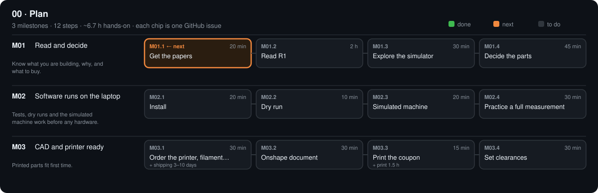

# 00 · Plan

[Design](design.md) · [Research](research.md) · [Parts list](bom.csv) · [3D files](3d/)

## M01 · Read and decide

Know what you are building, why, and what to buy. · 0/4 steps done · ~3.6 h hands-on · ~1 wk

### M01.1 Get the papers

**Time** 20 min · **Needs** laptop with Ubuntu (WSL) · browser

#### Do

1. `bash scripts/get_papers.sh`
2. For each line under *Blocked for scripts*: open it in your browser, save the PDF to Downloads.
3. `bash scripts/get_papers.sh --from /mnt/c/Users/<you>/Downloads`

#### Verify

- [ ] Second run prints only `have` / `took` lines and no *Blocked* list.
- [ ] `ls papers/open | grep R1` shows the R1 PDF.

#### If a check fails

- `took` missing for a file: the saved name differs; check `papers/papers.tsv` → `browser_name`.
- PDF opens as an HTML page: the publisher served a login page; download again from the article page.

#### Record

Nothing to record. Tick the boxes; `make done id=M01.1`.

### M01.2 Read R1

**Time** 2 h · **Needs** papers/open/R1_*.pdf

#### Do

1. Read R1 sections 2 (device), 3 (calibration), 4 (results).
2. Close the paper. In `phases/00-plan/design.md` → Results, answer in one line each: (1) which axes turn the sample, (2) why the camera never moves, (3) what the mirror test calibrates, (4) why a 5° minimum light–camera angle.

#### Verify

- [ ] Your four answers match README → *The machine* and *Theory and equations* (open them only now).

#### If a check fails

- An answer is wrong: re-read that part of R1 section 2 or 3 and correct the line.

#### Record

The four answers in phases/00-plan/design.md → Results; commit.

### M01.3 Explore the simulator

**Time** 30 min · **Needs** docs/index.html in a browser

#### Do

1. Open `docs/index.html`. Drag to orbit; scroll to zoom; double-click to reset.
2. Press ▶ Demo. Drag *Build stage* from 1 to 17 and watch parts appear.
3. Set M4 = 60, M3 = 30. Then M4 = 60, M3 = 25.
4. Calibration lab: hidden table error +0.8°; press *Run calibrate mirror*; then drag *lamp drift* to 0.2 %.

#### Verify

- [ ] M4 60 / M3 30 shows *Specular geometry ✓*; M3 25 does not.
- [ ] Calibration lab: −0.80° WARN before, 0.00° PASS after calibrate; drift 0.2 % → FAIL.
- [ ] Without notes, sketch the machine: M1–M4, light, camera, zero point.

#### If a check fails

- Page blank: open it with Chrome or Firefox (not a preview pane).

#### Record

Optional: sketch photo as `phases/00-plan/sketch.jpg`. Tick the boxes; `make done id=M01.3`.

### M01.4 Decide the parts

**Time** 45 min · **Needs** `PARTS.md` (on GitHub: open it → ✏️)

#### Do

1. Read each part's *why* line in `PARTS.md`.
2. Tick `[x]` the parts you agree with; `status: have` for ones you own; `status: swap` + `note:` for ones you want changed; `status: skip` for ones you won't use.
3. Tools: set `have` on each TLS row (00 · Tools) you own. Optional kits: tick the SPC rows (spectral, +$17), MSK rows (colour bands + polarizers, +$30), CAM-04/05 (second camera: no camera moves, +$81), CAL-03 (chrome balls, +$10), ENC-01/03 (drape, only if M21.2 fails) and STA rows (standalone, +$38) only if you want them.
4. Commit (*Commit changes* on GitHub, or `make publish m="M01.4 parts decided"` locally).

#### Verify

- [ ] Stages 01–03 headings in `PARTS.md` read `N/N decided` (nothing left `suggested`).
- [ ] Summary table: *Still to buy* core ≤ $450; `make check` prints four `OK`.

#### If a check fails

- A line stays `suggested` after ticking: the box must read `[x]` with no space inside.
- `swap` parts: tell me the replacement, or add it with `python tools/new.py part …`, then `skip` the old one.

#### Record

`PARTS.md` committed. Tick the boxes; `make done id=M01.4`.

## M02 · Software runs on the laptop

Tests, dry runs and the simulated machine work before any hardware. · 0/4 steps done · ~1.3 h hands-on · ~1 wk

### M02.1 Install

**Time** 20 min · **Needs** laptop · internet

#### Do

1. In the repo folder: `make setup` (once).
2. `source .venv/bin/activate` (every new terminal).
3. `make all`

#### Verify

- [ ] `make all` ends with `passed` and no `failed`, after four `OK` lines from the check.

#### If a check fails

- `python3-venv` missing: `sudo apt install -y python3-venv`, then `make setup`.
- `ERR` lines: each names a file; `make build` then `make check` again.

#### Record

Tick the boxes; `make done id=M02.1`.

### M02.2 Dry run

**Time** 10 min · **Needs** M02.1

#### Do

1. `opengonio check-pose M4=60 M3=30`
2. `opengonio --dry-run move M4=80 M3=25`
3. `opengonio check-pose M4=10 M3=0`

#### Verify

- [ ] First: `"safe": true`, `theta_i` = `theta_r` = 30.0.
- [ ] Second prints `G53 G1 X80.0000 Y25.0000 F600`.
- [ ] Third: `"safe": false` (light would hit the camera) and exit code 2.

#### If a check fails

- `command not found`: run `source .venv/bin/activate` first.

#### Record

Tick the boxes; `make done id=M02.2`.

### M02.3 Simulated machine

**Time** 20 min · **Needs** M02.1

#### Do

1. `make sim`
2. `opengonio --cal data/sim/try.yaml --sim mirror --sim-error M3=0.8 capture mirror --theta 30 --out data/sim/a`
3. `opengonio --cal data/sim/try.yaml verify data/sim/a`; `opengonio --cal data/sim/try.yaml curve data/sim/a`
4. Open `data/sim/a/curve.svg` in a browser.
5. `opengonio --cal data/sim/try.yaml calibrate mirror data/sim/a`
6. Capture again with `--out data/sim/b` (same `--sim-error`), then verify `data/sim/b`.

#### Verify

- [ ] `make sim` ends with `"result": "ALL PASS"`.
- [ ] First verify: `mirror_peak_error_deg` = −0.8, `result` WARN; the chart peak sits left of the orange line.
- [ ] Second verify: `mirror_peak_error_deg` within ±0.1, `result` PASS.

#### If a check fails

- `ALL PASS` missing: `data/sim/summary.json` → `checks` shows which one is false; run `make test`.

#### Record

Nothing to commit (`data/sim/` is ignored). Tick the boxes; `make done id=M02.3`.

### M02.4 Practice a full measurement

**Time** 30 min · **Needs** M02.3

#### Do

1. `C="--cal data/sim/p.yaml"; G="--sim-gamma 2.2"`
2. `opengonio $C --sim ptfe $G capture dark --out data/sim/dark && opengonio $C calibrate dark data/sim/dark`
3. `opengonio $C --sim ptfe $G capture linearity --out data/sim/lin && opengonio $C calibrate linearity data/sim/lin`
4. `opengonio $C --sim ptfe $G capture white --out data/sim/white && opengonio $C calibrate white data/sim/white`
5. `opengonio $C --sim plastic $G capture inplane --step 10 --out data/sim/plastic`
6. `opengonio $C curve data/sim/plastic && opengonio $C fit data/sim/plastic`; open `fit.svg`.

#### Verify

- [ ] `calibrate linearity` prints `gamma` 2.2 ± 0.1.
- [ ] `fit` prints base_color 0.20 ± 0.02, roughness 0.30 ± 0.02, metallic ≤ 0.05 (the simulated plastic).
- [ ] In `fit.svg` the lines pass through the dots.

#### If a check fails

- `brdf_per_sr` blank / fit error: a calibrate step was skipped; `opengonio $C calibrate show` lists what is missing.

#### Record

This is exactly stage 07 on real hardware. Tick the boxes; `make done id=M02.4`.

## M03 · CAD and printer ready

Printed parts fit first time. · 0/3 steps done · ~1.2 h hands-on · ~1 wk

### M03.1 Onshape document

**Time** 30 min · **Needs** free Onshape account

#### Do

1. Create document **OpenGonio**; add Variable Studio `OG globals` with the values in `phases/00-plan/design.md` → Onshape set-up.
2. Insert → Import `phases/00-plan/3d/PLAN-01_tolerance_coupon.step`.

#### Verify

- [ ] Coupon imports as one solid (Parts list: 1 part, not a mesh).

#### If a check fails

- Imported as a mesh: you picked the .stl; import the .step.

#### Record

Onshape link under Onshape set-up in `phases/00-plan/design.md`; commit.

### M03.2 Print the coupon

**Time** 15 min (+ print 1.5 h) · **Needs** TLS-01 3D printer · PETG

#### Do

1. Slice `phases/00-plan/3d/PLAN-01_tolerance_coupon.stl`: PETG, 0.2 mm layers, 4 walls, 25 % infill, no supports.
2. Print; let it cool on the bed.

#### Verify

- [ ] Holes round (no elephant foot at the bottom layer); calipers: coupon length within ±0.3 mm of the model.

#### If a check fails

- Bottom flare: lower the first-layer squish or enable elephant-foot compensation (0.2 mm).

#### Record

Tick the boxes; `make done id=M03.2`.

### M03.3 Set clearances

**Time** 30 min · **Needs** 5 × M3 × 10 from FRM-06 · FRM-08 608 bearings (3) · TLS-03 hex key 2.5 mm · TLS-06 calipers

#### Do

1. Drive one M3 × 10 into each of the 5 holes (2.5 → 2.9 mm) with the hex key, slowly, until the head touches; back it out.
2. Push a 608 into each of the 3 pockets by thumb.
3. Pick the smallest hole where the screw goes all the way without splitting the coupon and holds when you pull on it → `M3_TAP` = that hole Ø.
4. Pick the pocket where the 608 presses in and does not fall out upside down → `CLEAR` = pocket Ø − 22.0.
5. Set both at the top of `tools/cad/parts.py`.
6. Once: `.venv/bin/pip install cadquery numpy-stl matplotlib`; then `make parts`.

#### Verify

- [ ] `git status` lists changed `.step` / `.stl` files in `phases/*/3d/`.
- [ ] `make check` prints four `OK`.

#### If a check fails

- Every screw spins loose: print 10 °C hotter (better layer bonding) and reprint the coupon.
- `make parts` import error: the cadquery install failed; re-run the pip line and read its last error.

#### Record

Commit: `make publish m="M03.3 clearances set"`.

[Sources](../../REFERENCES.md): R1 · R2 · R5 · R6 · R7 · R8 · R24 · R27 · R30 · R47 · R50 · R56 · R63 · R64 · R68 · R69 · R79 · R80 · S3 · S18 · S20 · G1 · G2 · G6 · G7 · G33 · G35 · G36 · G38 · T1 · T4 · T11 · T17 · T35 · T38 · T40 · V19 · V20 · N6 · N12 · N14 · N50 · H28 · H29 · H35 · H44 · H56 · H57 · H58 · H60 · P1 · P15 · P17 · P23 · P31 · P32 · C3 · K1 · K5 · K19 · L1 · L4 · L9 · L18 · F9 · F10 · F11 · E5
