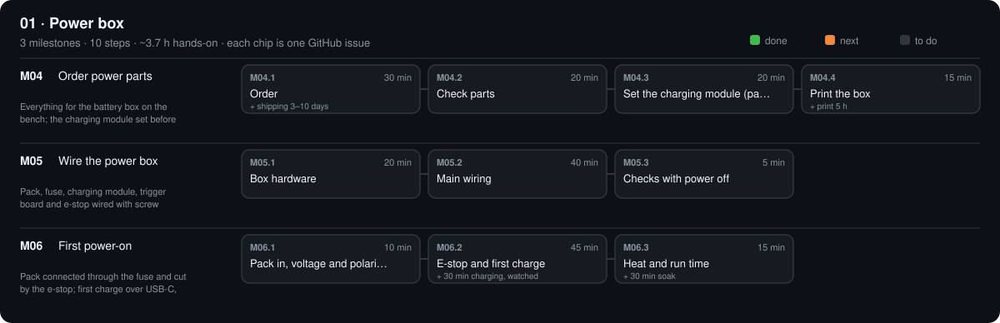

# 01 · Power box

$131.06 · total so far $195.02 / $630

[Design](design.md) · [Research](research.md) · [Parts list](bom.csv) · [3D files](3d/) · [Tests](test.csv)

## M04 · Order power parts

Everything for the battery box on the bench; the charging module set before the pack is connected. · 0/4 steps done · ~1.4 h hands-on · ~2 wk

### M04.1 Order

**Time** 30 min (+ shipping 3–10 days) · **Needs** `PARTS.md` → 01 · Power box · FRM-06 screws (03 · Frame) · `PARTS.md` → 00 · Tools

#### Do

1. Order every stage-01 part ticked `[x]` (status `agreed`), using its link.
2. FRM-06 screws were ordered in M03.1; the box uses them.
3. Tools: order the TLS rows (00 · Plan; their own total, not in the machine total): multimeter (TLS-05) and wire stripper (TLS-04) are needed now; the printer and ABS were ordered in M03.1.
4. Charging needs a USB-C charger with a 20 V profile, ≥ 30 W: the laptop's, if it charges over USB-C, or any USB-C PD charger ≥ 30 W.
5. In `PARTS.md` set each ordered part to `status: ordered` and fill `paid:`.

#### Verify

- [ ] Stage 01 in `PARTS.md` has no `agreed` or `suggested` parts left; *Paid so far* went up.
- [ ] Tools TLS-02 to TLS-06 are `have` or `ordered`.

#### If a check fails

- Part out of stock: its *Must meet* line says what a substitute needs (pack: assembled 6S with a protection board, ≥ 5 A; charging module: CC/CV with output anti-backflow, screw terminals); set `swap` + `note:`, or add one with `python tools/new.py part …`.

#### Record

Commit the dated BOM.

### M04.2 Check parts

**Time** 20 min · **Needs** all PWR parts · TLS-05 multimeter · calipers (TLS-06)

#### Do

1. Pack (PWR-21): look it over (no dents, no swelling, leads insulated); DC V across its leads. Put the 25.2 V wall charger that came with it away: it is not used.
2. Measure the pack (L × W × H), the DROK (PWR-29, L × W × H) and the trigger board (PWR-27, L × W). If any differs from `PACK` / `DROK` / `TRIG` in `tools/cad/parts.py` by more than 1 mm, change it there and run `make parts` before printing.
3. Fuse (PWR-05, 3.15 A T) into the holder (PWR-04): Ω across the holder's two leads.

#### Verify

- [ ] Pack 18.0–24.0 V, positive on the red lead.
- [ ] Fuse holder < 1 Ω.
- [ ] E-stop (PWR-28) has a contact block marked NC with screw terminals.
- [ ] Pack, DROK and trigger within 1 mm of the CAD values (or the CAD updated).

#### If a check fails

- Pack below 18 V, swollen or dented: return it; don't charge it.
- Pack above 24.0 V: it shipped charged past 4.0 V per cell; don't connect it to the motor board until it reads ≤ 24.0 V (ask in an issue before improvising a load).
- Wrong part: return it now; don't substitute ratings (pack 6S with protection board, e-stop NC ≥ 3 A at 24 V DC).

#### Record

`status: have` per part in `PARTS.md` as it arrives; measured sizes in design.md; commit.

### M04.3 Set the charging module (pack not connected)

**Time** 20 min · **Needs** PWR-27 trigger · PWR-29 DROK · USB-C charger · TLS-05 multimeter · two 10 cm pieces of PWR-15 wire · small screwdriver

#### Do

1. Trigger board DIP switch to **20 V**. Trigger `+` / `−` → DROK IN `+` / `−` (10 cm red / black). Nothing on DROK OUT.
2. Plug the USB-C charger into the trigger. Read its display; then DROK's LCD (input V).
3. DROK's CV pot until its LCD reads **24.00 V** out; check with the meter on OUT `+` / `−` (T2).
4. Meter on 10 A, leads into OUT `+` and OUT `−` (the meter is the short). Turn the CC pot until the meter reads **1.00 A** (T2). Remove the meter, unplug the charger.

#### Verify

- [ ] Trigger display 20 V; DROK input 19.5–20.5 V.
- [ ] T2: open 23.95–24.05 V; short 0.95–1.05 A.

#### If a check fails

- Trigger reads 5 V: the charger has no 20 V profile or the DIP switch is off 20 V; use the laptop's charger or another ≥ 30 W PD charger.
- Voltage won't move: you are turning the CC pot; the LCD shows which value is changing (see the listing's pictures).
- Meter reads 0 A: meter lead still in the V socket; move it to 10 A.

#### Record

T2 in `phases/01-power/test.csv`; mark both pots with a dot of paint or a strip of tape so they don't get turned.

### M04.4 Print the box

**Time** 15 min (+ print 5 h) · **Needs** FIL-01 ABS · TLS-01 enclosed printer

#### Do

1. Print `phases/01-power/3d/PWR-18a_power_box.stl` and `PWR-18b_power_lid.stl` (lid top face down, ribs up): ABS (settings from M03.3, brim on), 0.2 mm, 4 walls, 30 % infill.

#### Verify

- [ ] Walls not split; the Ø22.3 e-stop hole is round (calipers 22.2–22.5 mm).
- [ ] Pack, DROK and trigger board drop into their floor frames without forcing; the trigger's USB-C lines up with the +X opening; the fuse holder sits in its cradle.

#### If a check fails

- Hole too tight: scale the lid XY by +1 % in the slicer and reprint (no drilling).

#### Record

Tick the boxes; `make done id=M04.4`.

## M05 · Wire the power box

Pack, fuse, charging module, trigger board and e-stop wired with screw terminals and lever connectors only; nothing soldered. Pack leads stay out until M06. · 0/3 steps done · ~1.1 h hands-on · ~1 wk

### M05.1 Box hardware

**Time** 20 min · **Needs** PWR-18 box + lid · PWR-28 e-stop · PWR-27 trigger · PWR-29 DROK (set in M04.3) · TLS-09 double-sided tape · 4 × M2 × 10 · TLS-02 / TLS-03

#### Do

1. Drive the 4 M2 × 10 into the box posts once and back out (cuts the threads).
2. E-stop (PWR-28) through the lid hole, ring nut tight.
3. DROK and trigger board into their floor frames, double-sided tape under each; trigger USB-C into the +X opening. Keep the trigger → DROK IN wires from M04.3.

#### Verify

- [ ] Twisting each part by hand: nothing rotates or lifts.
- [ ] A USB-C plug goes into the trigger from outside the box.
- [ ] Lid closes on 4 × M2 × 10 with no gap.

#### If a check fails

- Lid screw spins: that post's hole is too big; reprint the box with a smaller `M2_TAP`.
- USB-C plug doesn't reach: the trigger sits back from the wall; peel it off and push it to the +X end of its frame.

#### Record

Tick the boxes; `make done id=M05.1`.

### M05.2 Main wiring

**Time** 40 min · **Needs** PWR-20 lever connectors · PWR-15 18 AWG pair (1 m) · PWR-04 fuse holder + PWR-05 fuse · TLS-04 stripper · TLS-02 flat screwdriver

#### Do

1. Pack **not** in the box, no USB-C charger. E-stop pressed.
2. Fuse holder in its cradle. One holder lead into a 2-way lever connector (BAT+, pack red goes in here in M06). Other holder lead into a 3-way connector (FUSED).
3. FUSED connector ← DROK OUT `+` (short red) and a red wire to e-stop NC terminal 1. E-stop NC terminal 2 → the whole red wire, out through the J3 slot (it will later pass through the over-travel switch, M14.1, on its way to the SKR Pico).
4. A 3-way connector (GND): DROK OUT `−` (short black) + the whole black wire, out through the motor-power slot; one opening left for the pack's black lead (M06). Leave both long ends free; zip-tie the pair to the box.
5. Tug every wire: none slips out.

#### Verify

- [ ] Continuity beeps along each row of the netlist (`phases/01-power/design.md`).
- [ ] No beep red out ↔ black out.

#### If a check fails

- No beep through the e-stop: you used the NO contact; move the wires to NC.
- No beep through the fuse: fuse not seated; open the holder and push it in.
- Wire pulls out: strip longer (11 mm in lever connectors), twist, re-close the lever.

#### Record

Tick each row on the printed netlist. Tick the boxes; `make done id=M05.2`.

### M05.3 Checks with power off

**Time** 5 min · **Needs** TLS-05 multimeter · pack not connected · e-stop released

#### Do

1. Ω range: red out to black out (T1); FUSED connector to GND connector.

#### Verify

- [ ] T1 > 10 kΩ (or OL) both ways (the DROK's output may show a slowly rising value: its capacitors charging from the meter).

#### If a check fails

- T1 low: a stray strand bridges + and − at the DROK or e-stop terminals; re-strip and re-tighten.

#### Record

T1 in `phases/01-power/test.csv` (date, value, PASS/FAIL).

## M06 · First power-on

Pack connected through the fuse and cut by the e-stop; first charge over USB-C, watched. · 0/3 steps done · ~1.2 h hands-on · ~1 wk

### M06.1 Pack in, voltage and polarity

**Time** 10 min · **Needs** PWR-21 pack · TLS-05 multimeter · red/black out leads free (no motor board)

#### Do

1. E-stop pressed, no USB-C charger. Pack upright in its pocket, leads toward +X.
2. Pack black lead into the GND connector, then pack red lead into the BAT+ connector (this is the power switch for service: lift this lever to isolate the pack).
3. Release the e-stop. DC V: black probe on black out, red probe on red out (T3).

#### Verify

- [ ] T3 = +18.0 to +24.0 V (a plus sign: polarity right), the same as the pack read in M04.2.
- [ ] Nothing warm after 1 min.

#### If a check fails

- Reads negative: pack leads swapped; open the BAT+ lever first, then swap.
- Reads 0 V: fuse blown or not seated (open BAT+ first), or the e-stop still pressed; a blown fuse means a short: find it before replacing it (T1).

#### Record

T3 in `test.csv`.

### M06.2 E-stop and first charge

**Time** 45 min (+ 30 min charging, watched) · **Needs** USB-C charger · TLS-05 multimeter + temperature probe · lid off for this step

#### Do

1. Press the e-stop; read the out leads after 1 s (T5). Release.
2. E-stop pressed. Temperature probe taped to the side of the pack. Plug the USB-C charger into the trigger through the +X opening (T13).
3. Read DROK's LCD: output current and voltage. Stay with it for 30 min; read the pack temperature every 10 min.
4. Unplug the charger. DC V on the trigger's `+` / `−` screws (no back-feed from the pack).

#### Verify

- [ ] T5 < 1 V within 1 s.
- [ ] T13: trigger 20 V; DROK ≤ 1.05 A, voltage rising toward 24.0 V; pack ≤ 45 °C after 30 min.
- [ ] Charger unplugged: trigger screws < 1 V.

#### If a check fails

- Stays high on e-stop: J3 loop bypassed or NC/NO swapped.
- DROK shows 0 A: the pack is already at 24.0 V (full: fine), or DROK OUT is not in the FUSED/GND connectors.
- Pack above 45 °C, swelling or a smell: unplug the charger, open BAT+, move the pack outdoors; don't use it.
- Trigger screws read pack voltage with the charger out: the DROK has no output anti-backflow; open BAT+, return it, never plug a USB-C device into the trigger.

#### Record

T5, T13 in `test.csv`.

### M06.3 Heat and run time

**Time** 15 min (+ 30 min soak) · **Needs** TLS-05 temperature probe · optional: the SKR Pico with one motor holding, from M08

#### Do

1. Lid closed, 30 min on with the SKR Pico + one motor holding if you have them; probe through the J3 slot into the box air (T9).
2. Optional (T15): charge to full (DROK current falls below 0.1 A), unplug the charger, run the in-plane demo plan in a loop and note when it stops (the protection board cuts the pack; recharge straight away).

#### Verify

- [ ] T9 box air ≤ 45 °C.
- [ ] T15 ≥ 3 h (when measured).

#### If a check fails

- Box air hot: the DROK runs warm while charging; leave the lid off while charging and tell us in an issue.

#### Record

T9 (T15) in `test.csv`; label the box *24 V Li-ion · USB-C charge · lift BAT+ to isolate*; commit.

> **Safety:** No mains in the machine: a 24 V lithium-ion pack with its own protection board, a 3.15 A fuse and the e-stop. Before touching any screw terminal: unplug the USB-C charger and lift the pack's red lead out of its lever connector. Charge on a hard surface; don't leave it charging unattended until M06 has passed. A pack that swells, smells or passes 45 °C: unplug it, move it outdoors away from anything that burns, don't charge it again.

[Sources](../../REFERENCES.md): N48 · N49 · N51 · H9 · H43 · P6 · P20 · P47 · P49 · P55 · P56 · P57
