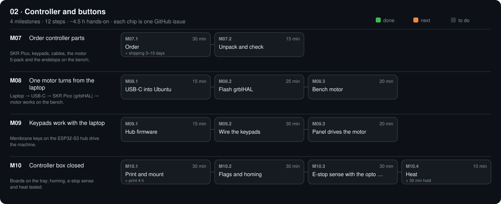

# 02 · Controller and buttons

$79.68 · total so far $216.02 / $630

[Design](design.md) · [Parts list](bom.csv) · [3D files](3d/) · [Tests](test.csv)

## M07 · Order controller parts

E4, Pico H, keypads, one motor and one endstop on the bench. · 0/2 steps done · ~40 min hands-on · ~2 wk

### M07.1 Order

**Time** 30 min (+ shipping 3–10 days) · **Needs** `PARTS.md` → 02 · Controller and buttons

#### Do

1. Order every stage-02 part ticked `[x]`.
2. Also order LAR-02 (one NEMA 17) and LAR-05 (one TCST2103 endstop) from stage 04 for bench tests.
3. Set them `status: ordered` with `paid:` in `PARTS.md`.

#### Verify

- [ ] Stage 02 has no `agreed` or `suggested` parts left.

#### If a check fails

- E4 sold out: its *Must meet* line names what a replacement needs; its pins differ — update `firmware/fluidnc/config.yaml`.

#### Record

Commit the dated BOM.

### M07.2 Unpack and check

**Time** 10 min · **Needs** CTL parts · PWR-19 breadboard · PWR-10 PC817 · PWR-11 10 k

#### Do

1. Pico H: both 20-pin headers fitted. Keypads: 5-wire tails intact. Jumpers: male–female.
2. Find each keypad's common pin: meter on continuity, one probe on a tail pin, press keys; the common pin beeps with every key.

#### Verify

- [ ] Common pin found on both keypads (write it on the tail with a marker).

#### If a check fails

- No pin beeps with all keys: tail not fully seated in the meter probe; use a jumper's male end as a probe tip.

#### Record

`status: have` per arrived part in `PARTS.md`; commit.

## M08 · One motor turns from the laptop

Laptop → E4 → motor works on the bench. · 0/3 steps done · ~55 min hands-on · ~1 wk

### M08.1 USB into Ubuntu

**Time** 15 min · **Needs** CTL-01 E4 · CTL-03 USB cable · Windows PowerShell (admin)

#### Do

1. Plug the E4 into the laptop by USB (no 24 V needed).
2. PowerShell (admin): `usbipd list`; `usbipd bind --busid <E4 busid>`; `usbipd attach --wsl --busid <E4 busid>`.
3. Ubuntu: `sudo usermod -aG dialout $USER && newgrp dialout`; `ls /dev/ttyUSB*`.

#### Verify

- [ ] `ls` prints `/dev/ttyUSB0`.

#### If a check fails

- Not listed in `usbipd list`: charge-only cable; swap it.
- Vanishes after replug: run `usbipd attach` again (needed after every replug).

#### Record

Tick the boxes; `make done id=M08.1`.

### M08.2 Flash FluidNC

**Time** 20 min · **Needs** M08.1

#### Do

1. `bash scripts/e4.sh flash`; close its terminal with Ctrl+].
2. `bash scripts/e4.sh wifi "SSID" "PASSWORD"`; press E4 reset.
3. `bash scripts/e4.sh config fluidnc.local`; press E4 reset.

#### Verify

- [ ] `opengonio send '$I'` lists `FluidNC`.
- [ ] `opengonio send '?'` prints a line starting `<Idle|MPos:` (or `<Alarm` before homing).

#### If a check fails

- `fluidnc.local` not found: use the IP the E4 prints on boot, or join hotspot FluidNC / 12345678 and use 192.168.0.1.

#### Record

C1 (USB) in `phases/02-controller/test.csv`.

### M08.3 Bench motor

**Time** 20 min · **Needs** LAR-02 motor · power box · tape flag on the shaft

#### Do

1. Adapter unplugged. Red out → E4 VIN `+`, black out → E4 VIN `−` (screw terminal). Motor → E4 X socket. Plug in, e-stop released.
2. `opengonio send 'G91' 'G1 X10 F600' 'G1 X-10 F600' 'G90'`
3. `opengonio send 'G91' 'G1 X360 F300' 'G90'`; press the e-stop halfway.

#### Verify

- [ ] Shaft turns, then returns to the tape mark.
- [ ] E-stop stops it at once; after release `opengonio send '?'` shows `Alarm` (must re-home).

#### If a check fails

- Motor buzzes, no turn: coil pairs crossed; swap the middle two wires of its plug.
- Wrong direction: flip `direction_pin` in `firmware/fluidnc/config.yaml`, `bash scripts/e4.sh config`.

#### Record

Note the result under C7 in `test.csv`.

## M09 · Keypads work with the laptop

Membrane keys drive the machine. · 0/3 steps done · ~1.1 h hands-on · ~1 wk

### M09.1 Hub firmware

**Time** 15 min · **Needs** CTL-02 Pico H · CTL-04 USB cable

#### Do

1. Hold BOOTSEL, plug the Pico in, copy the MicroPython .uf2 onto `RPI-RP2`.
2. WSL: `usbipd attach` the Pico too.
3. `bash scripts/pico.sh`

#### Verify

- [ ] `pico.sh` prints `PONG OpenGonio-hub 2`.

#### If a check fails

- `mpremote` can't find it: `ls /dev/ttyACM*` empty → attach with usbipd again.

#### Record

C4 (PING part) in `test.csv`.

### M09.2 Wire the keypads

**Time** 30 min · **Needs** 2 × CTL-05 keypads · CTL-07 jumpers · pin table in `phases/02-controller/design.md`

#### Do

1. Keypad A: male jumper ends into its tail; common → Pico GND; keys 1–4 → GP2 HOME, GP3 START, GP4 STOP, GP5 LIGHT.
2. Keypad B: common → GND; key 1 → GP6 NEXT.
3. Common ground (always): one jumper from the E4 TH1 ground pin to Pico GND: the M1 endstop (M27.1) and PAUSE need it without the laptop.
4. Optional PAUSE: keypad B key 2 → E4 GPIO39 (TH1 signal pin).
5. `python -m serial.tools.miniterm /dev/ttyACM0 115200`, press each key.

#### Verify

- [ ] Each press prints its own `BTN <NAME>` exactly once.

#### If a check fails

- Nothing on any key: common on a key pin; redo M07.2.
- Two lines per press: the firmware debounces 30 ms — reseat the jumper on that pin.

#### Record

C4 in `test.csv`.

### M09.3 Panel drives the motor

**Time** 20 min · **Needs** bench motor on X

#### Do

1. `opengonio panel`
2. Press HOME, LIGHT, NEXT, START, then STOP.
3. Optional PAUSE: start again; press PAUSE during a move; then `opengonio send '~'`.

#### Verify

- [ ] Each press prints its action in the panel log.
- [ ] PAUSE (if wired) freezes the shaft even with the laptop unplugged; `~` resumes.

#### If a check fails

- PAUSE does nothing: GPIO39 pin wrong in config; check the pin table.

#### Record

C5, C6 in `test.csv` (C6 `n/a` if PAUSE not wired).

## M10 · Controller box closed

Boards boxed; links, homing, e-stop sense and heat tested. · 0/5 steps done · ~2.2 h hands-on · ~1 wk

### M10.1 Print and mount

**Time** 30 min (+ print 4 h) · **Needs** CTL-10 prints · 4 × M3 × 8 · PWR-19 breadboard

#### Do

1. Print `CTL-10a_button_panel.stl`, `CTL-10b_controller_tray.stl`.
2. Drive M3 × 8 into the 4 E4 standoffs once; mount the E4 (holes 83.6 × 60.6 mm). Turn the Pico H components-down (header pins up) and press its corner holes over the tray pegs (it was flashed in M09.1).
3. Breadboard: peel its backing, stick it in the recess. Keypads: peel and stick into the panel recesses, tails through the slots.

#### Verify

- [ ] E4 sits flat on all four standoffs; USB ports reachable through the slots.
- [ ] Pico doesn't lift when you unplug a jumper.

#### If a check fails

- Holes off: measure your E4 hole spacing, set it in `tools/cad/parts.py` (CTL-10b), `make parts`, reprint.

#### Record

Tick the boxes; `make done id=M10.1`.

### M10.2 WiFi and Bluetooth

**Time** 30 min · **Needs** phone or laptop Bluetooth

#### Do

1. In `software/config/machine.yaml`: `controller.transport: tcp`; `opengonio status`.
2. Pair the E4 over Bluetooth; set `transport: serial`, `port: /dev/rfcomm0` (or the COM port); `opengonio status`.
3. Set it back to the link you will use.

#### Verify

- [ ] Both links print `<Idle|MPos:` or `<Alarm|MPos:`.

#### If a check fails

- Bluetooth missing: flash the BT build from installer.fluidnc.com.

#### Record

C1 (WiFi, BT) in `test.csv`.

### M10.3 Flags and homing

**Time** 30 min · **Needs** LAR-05 endstop · CTL-06: 3 double-ended XH leads + two 3-pin housings · a card to block it

#### Do

1. Endstop lead: push 3 leads into a 3-pin XH housing at each end, same order both ends (V, G, S from the E4 pin table). One end into the E4 X-MIN socket, the other onto the module's 3 pins (an XH housing fits a 2.54 mm header).
2. `opengonio send '?'` with the slot open, then blocked.
3. Motor on X, endstop flag taped to the shaft: `opengonio send '$HX'`.

#### Verify

- [ ] Blocked shows `Pn:X`; open shows no `Pn`.
- [ ] `$HX` turns until the flag cuts the slot and stops; `?` shows MPos X = 20.

#### If a check fails

- Never stops: inverted input; toggle `:low` on the home pin in config.yaml.
- Module LED never lights: V and G swapped (flip the housing at the module end).

#### Record

C2, C3 in `test.csv`.

### M10.4 E-stop sense on the breadboard

**Time** 30 min · **Needs** PWR-10 PC817 · PWR-11 10 k · 2 cut jumpers · M-F jumpers

#### Do

1. PC817 across the breadboard trench (dot = pin 1). 10 k from pin 1's row to a free row (*24 V sense*).
2. Cut jumper from E4 VIN `+` (bare end under the screw with the main lead) → *24 V sense* row; another from E4 VIN `−` → pin 2's row.
3. Pin 4's row → Pico GP7; pin 3's row → Pico GND (male–female jumpers).
4. Motor holding (`opengonio send '$ME'`): measure E4 VIN (T4). Press the e-stop: watch the hub output and the panel; release; `opengonio home`.

#### Verify

- [ ] T4 ≥ 23.0 V.
- [ ] Hub prints `POWER 0` on e-stop, `POWER 1` after release (T7); moves refused until HOME (C7).

#### If a check fails

- Always `POWER 0`: PC817 backwards (pins 1/2 vs 3/4) or the 10 k in the wrong row.
- Always `POWER 1`: pin 4 not on GP7, or pin 3 not on GND.

#### Record

T4, T7 in `phases/01-power/test.csv`; C7 in `phases/02-controller/test.csv`.

### M10.5 Heat

**Time** 10 min (+ 30 min hold) · **Needs** TLS-05 temperature probe

#### Do

1. `opengonio send '$ME'`, motor holding at 0.8 A run current for 30 min, lid on; probe on the driver area.

#### Verify

- [ ] Driver area ≤ 80 °C (C8).

#### If a check fails

- Hotter: fit the optional CTL-08 fan on `M62 P2`, or lower `run_amps` to 0.7.

#### Record

C8 in `test.csv`; commit `make publish m="M10 controller done"`.

> **Safety:** Never plug or unplug motors with 24 V on.

[Sources](../../REFERENCES.md): R24 · R25 · R42 · R81 · N48 · H1 · H2 · H4 · H5 · H6 · H7 · H8 · H23 · H24 · H25 · H43 · H54 · P22 · C1 · C2 · C3 · C4 · C5 · C6 · C7 · C8 · C9 · C10 · C11
