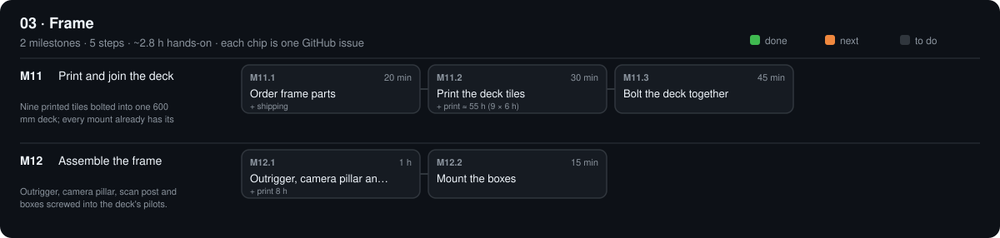

# 03 · Frame

$71.96 · total so far $287.98 / $630

[Design](design.md) · [Parts list](bom.csv) · [3D files](3d/)

## M11 · Place the base mounts

Every mount screwed to the board from a paper template; no cutting, no drilling. · 0/3 steps done · ~1.6 h hands-on · ~1 wk

### M11.1 Order frame parts

**Time** 20 min (+ shipping) · **Needs** `PARTS.md` → 03 · Frame

#### Do

1. Order every stage-03 part ticked `[x]`; set them `ordered` with `paid:`.

#### Verify

- [ ] Stage 03 has no `agreed` or `suggested` parts left.

#### Record

Commit `PARTS.md`.

### M11.2 Print the template and mounts

**Time** 30 min (+ print 4 h) · **Needs** TLS-08 paper printing · tape · FIL-01 ABS

#### Do

1. Print `phases/03-frame/placement-template.svg` at 100 % in poster/tile mode; tape the tiles on the crosses.
2. Print 4 × `FRM-09b_foot.stl`, 2 × `FRM-09d_extrusion_saddle.stl`.

#### Verify

- [ ] The 100 mm bar measures 100 ± 0.5 mm.
- [ ] Tile joins: lines meet within 0.5 mm.

#### If a check fails

- Bar 97 mm: the printer scaled to fit; turn *fit to page* off.

#### Record

Tick the boxes; `make done id=M11.2`.

### M11.3 Screw down the mounts

**Time** 45 min · **Needs** FRM-01 plywood as bought · FRM-12 wood screws · TLS-02 Phillips #2 · TLS-06 calipers

#### Do

1. Template on the best face, centred (equal overhang on all sides), taped.
2. Saddles 1 and 2 on their outlines (x = 237 and 282), walls along the +X line; 4 screws each, straight down through the paper, firm, not over-tightened.
3. Leave the template on for the boxes (M12.4).

#### Verify

- [ ] Saddle centres 237 ± 1 and 282 ± 1 mm from the centre cross (tape).
- [ ] Nothing moves when you push it hard sideways.

#### If a check fails

- Screw spins without tightening: glue a wooden toothpick into the hole, snap it flush, drive the screw again.

#### Record

Photo `phases/03-frame/base.jpg`; commit.

## M12 · Assemble the frame

Board on feet with outrigger, camera pillar and post, scales and boxes. · 0/4 steps done · ~1.8 h hands-on · ~1 wk

### M12.1 Feet

**Time** 15 min · **Needs** 4 × FRM-09b feet · 8 × FRM-12 screws

#### Do

1. Board face down on a towel. A foot flush in each corner; 2 screws each.
2. Turn it over on the table where it will live.

#### Verify

- [ ] Board doesn't rock when pressed at each corner.
- [ ] No screw tip shows on the top face.

#### If a check fails

- Rocks: the table isn't flat; fold paper under the short foot. (No levelling needed: the optics reference the board, not gravity.)

#### Record

Tick the boxes; `make done id=M12.1`.

### M12.2 Outrigger, camera pillar and scan post

**Time** 45 min (+ print 3 h) · **Needs** 2 × FRM-02 2020 (outrigger + scan post) · 7 × FRM-03 T-nuts · 7 × M5 × 10 · FRM-09e post socket · FRM-09h camera pillar · FRM-09f end foot · TLS-07 tape + phone level app

#### Do

1. Print 2 × `FRM-09e_post_socket.stl` and 1 × `FRM-09f_end_foot.stl`.
2. Drop 2 T-nuts into each side slot of one 2020; lay it in the saddles with its inner end 215 mm from the board centre, running out over +X; end foot under it at x = 628 (just inside the scan post).
3. M5 × 10 through each saddle wall and the end foot into the T-nuts; tighten.
4. Camera pillar (FRM-09h) on the outrigger at x = 391.8 (measuring camera: lens front lands at 350); post socket at x = 674.4 with the 500 mm scan post (M5 × 10 + T-nut each). No tall post at the measuring camera: it would stand in the scan camera's view.

#### Verify

- [ ] Posts vertical: phone level app on two faces reads 90.0 ± 0.5°.
- [ ] Pillar and post centres 391.8 ± 1 and 674.4 ± 2 mm from the board centre (tape); pillar's M5 pilot at 150 ± 1 mm above the board.
- [ ] Outrigger level end to end (phone level app ±0.5°).

#### If a check fails

- Far end low: the end foot is 30 mm for 12 mm feet + 12 mm plywood + 6 mm saddle; shim it.

#### Record

Tick the boxes; `make done id=M12.2`.

### M12.3 Protractor scales

**Time** 30 min (+ print 2 h) · **Needs** 4 × FRM-09c · double-sided tape or glue

#### Do

1. Print 4 × `FRM-09c_protractor_segment.stl` (80° each).
2. Stick them end to end around the ring circle from 20° to 340° (0° = +X, toward the camera; the gap is the M4 motor).

#### Verify

- [ ] The 20° and 340° ends sit symmetric about the line board centre → camera pillar (string line).

#### Record

Tick the boxes; `make done id=M12.3`.

### M12.4 Mount the boxes

**Time** 15 min · **Needs** power box · controller box · 8 × FRM-12 screws

#### Do

1. Power box: 4 wood screws through its floor's OG-40 holes at the template crosses (220, −220), e-stop toward you.
2. Controller tray: 4 wood screws through its corner bosses at the template crosses (centre −190, 220).
3. Black wire along the board edge to E4 VIN `−`. Red wire for now straight to E4 VIN `+` (it gets the over-travel switch in M14.1).

#### Verify

- [ ] `opengonio status` still answers; e-stop still cuts (repeat T5).

#### Record

Photo `phases/03-frame/frame.jpg`; commit.

[Sources](../../REFERENCES.md): R1 · G10 · G38 · H30 · H38 · F1 · F2 · F3 · F5 · F7 · F8
