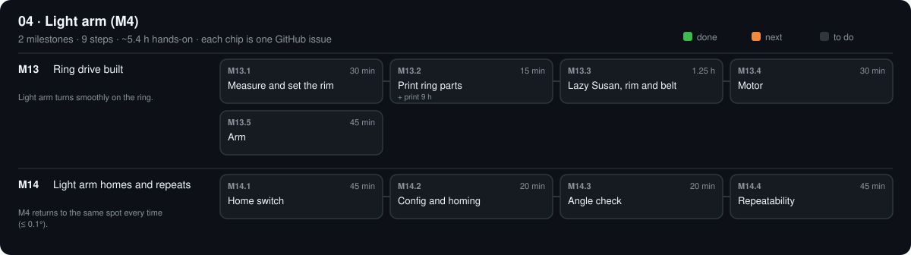

# 04 · Light arm (M4)

$41.40 · total so far $243.39 / $450

[Design](design.md) · [Parts list](bom.csv) · [3D files](3d/)

## M13 · Ring drive built

Light arm turns smoothly on the ring. · 0/5 steps done · ~3.2 h hands-on · ~1 wk

### M13.1 Measure and set the rim

**Time** 30 min · **Needs** LAR-01 lazy Susan · calipers

#### Do

1. Order the stage-04 parts ticked in `PARTS.md` (if not done); mark them `ordered`.
2. Measure the lazy Susan top-plate outer Ø and its 4 hole positions.
3. Set `RIM_TEETH` in `tools/cad/parts.py` so `RIM_R` ≈ plate radius − 5 mm; `python tools/cad/parts.py --only LAR-08a`.

#### Verify

- [ ] Printed `RIM_R` within 5 ± 1 mm of the plate edge.
- [ ] `gear_ratio` = `RIM_TEETH` / 20 noted.

#### Record

Plate Ø, `RIM_TEETH`, `gear_ratio` in phases/04-light-arm/design.md → Results.

### M13.2 Print ring parts

**Time** 15 min (+ print 9 h) · **Needs** PETG

#### Do

1. Print 8 × `LAR-08a_rim_segment.stl`, 1 × `LAR-08b_ring_motor_mount.stl`, 1 × `LAR-08c_arm_bracket.stl`, 1 × `LAR-08e_cross_clamp.stl`, 1 × `FRM-09g_washers.stl` (8 washers).

#### Verify

- [ ] Segments butt into a closed ring on the table (no gap > 0.5 mm).

#### Record

Tick the boxes; `make done id=M13.2`.

### M13.3 Lazy Susan, rim and belt

**Time** 1.25 h · **Needs** LAR-01 lazy Susan · LAR-03 belt · FRM-12 wood screws + 4 mm printed washers · M4 × 12 + nuts (FRM-06) · TLS-09 CA glue · TLS-04 cutter

#### Do

1. Lazy Susan centred on the template circle; #8 wood screws through its bottom-plate holes, each through a 4 mm printed washer (the steel plate is thin: without the washer the 16 mm screw pokes through the plywood).
2. Rim segments on the top plate: M4 × 12 + nut through every slot that lands on a plate hole; CA-glue the others to the plate.
3. Glue the GT2 belt teeth-out into the groove, ends butted, no gap; it ties the segments together.

#### Verify

- [ ] Count the belt teeth: equals `RIM_TEETH` ± 1.
- [ ] No tooth step at the joint (run a fingernail over it).
- [ ] No screw tip under the plywood.

#### If a check fails

- Gap at the joint: cut a 1-tooth filler from spare belt.

#### Record

Tooth count in design.md.

### M13.4 Motor

**Time** 30 min · **Needs** LAR-02 motor · LAR-04 20T pulley · LAR-08b mount · 4 × M3 × 8 · FRM-12 wood screws

#### Do

1. Motor on the mount plate (shaft down through the slot, 4 × M3 × 8); 20T pulley on the shaft, grub on the D flat, teeth level with the rim belt.
2. Mount on its template outline at 0° (+X), base outside the lazy Susan; slide it in until the pulley meshes the rim belt fully, then screw the base down (2 screws in the slots).

#### Verify

- [ ] Pulley teeth engage the rim belt across its full width; turning the ring by hand turns the motor, no skipped tooth.

#### If a check fails

- Skips under a light push: slide the mount 0.5 mm inward and re-tighten.

#### Record

Tick the boxes; `make done id=M13.4`.

### M13.5 Arm

**Time** 45 min · **Needs** LAR-08c bracket · 2 × FRM-02 2020 (upright + arm) · LAR-08e cross clamp · M4 × 12 + nuts · LSR-05 lamp body (stage 06, or a dummy)

#### Do

1. Arm bracket on the top plate at r ≈ 140 mm: M4 × 12 + nuts through its slots and two plate holes.
2. 2020 upright in the bracket socket (M5 × 10 + T-nut). Cross clamp on the upright; horizontal 2020 arm in its top channel pointing outward, so the lamp centre will sit 300 mm from the zero point at zero-point height (150 mm).

#### Verify

- [ ] Turning by hand 20 → 340°: no tight spot, no skipped tooth; the bracket never touches the motor.
- [ ] Lamp position: 300 ± 2 mm from the zero point, height 150 ± 2 mm.

#### Record

Commit.

## M14 · Light arm homes and repeats

M4 returns to the same spot every time (≤ 0.1°). · 0/4 steps done · ~2.2 h hands-on · ~1 wk

### M14.1 Home switch

**Time** 45 min · **Needs** LAR-05 TCST2103 · LAR-06 roller switch · flag on the arm

#### Do

1. Mount the TCST2103 so the arm flag cuts it at 20° (lead as in M10.3).
2. Roller over-travel switch (LAR-06) screwed to the base 3° beyond. Unplug the adapter; cut the red wire where it passes the switch, strip both ends, one under COM, one under NC.

#### Verify

- [ ] `opengonio send '?'` shows `Pn:X` with the flag in the slot.
- [ ] Pressing the roller switch drops E4 VIN to 0 V (and the hub prints `POWER 0`).

#### Record

Tick the boxes; `make done id=M14.1`.

### M14.2 Config and homing

**Time** 20 min · **Needs** `software/config/machine.yaml`

#### Do

1. Set `installed_phase: 4` and `M4.gear_ratio` (from M13.1).
2. `make test`
3. `opengonio home` ten times.

#### Verify

- [ ] Tests pass; home finishes 10/10; arm stops on the flag, never on the roller switch.

#### If a check fails

- Homes the wrong way: `homing.positive_direction` for X in `firmware/fluidnc/config.yaml`.

#### Record

10/10 in design.md.

### M14.3 Angle check

**Time** 20 min · **Needs** protractor scale FRM-09c

#### Do

1. `opengonio move M4=90`, read the scale; `M4=180`; `M4=270`.

#### Verify

- [ ] Each reading within ±0.5° of the command.

#### If a check fails

- Error grows with angle: wrong `gear_ratio`; ratio_new = ratio × commanded / read.

#### Record

Three readings in design.md.

### M14.4 Repeatability

**Time** 45 min · **Needs** LAR-09 laser + mirror · wall 2.0 m away

#### Do

1. Laser on the base, small mirror taped to the arm, spot on a wall 2.0 m away (0.1° = 7 mm).
2. `opengonio repeat M4 --at 60 --away 30 --n 20`; type each spot offset (mm).
3. `opengonio repeat M4 --at 60 --home --n 10`

#### Verify

- [ ] Both print `"pass": true` (every spot ≤ 7.0 mm from the mark).

#### If a check fails

- Spread > 7 mm: pinion mesh (slide the mount in 0.5 mm), pulley grub tight on the motor flat, wobble in the lazy Susan.

#### Record

Both JSON summaries in phases/04-light-arm/design.md → Results; commit.

[Sources](../../REFERENCES.md): R1 · G10 · N15 · N47 · H2 · H11 · H16 · H17 · H18 · H26 · P40 · P42 · P43 · P44 · M1 · M2 · M10
