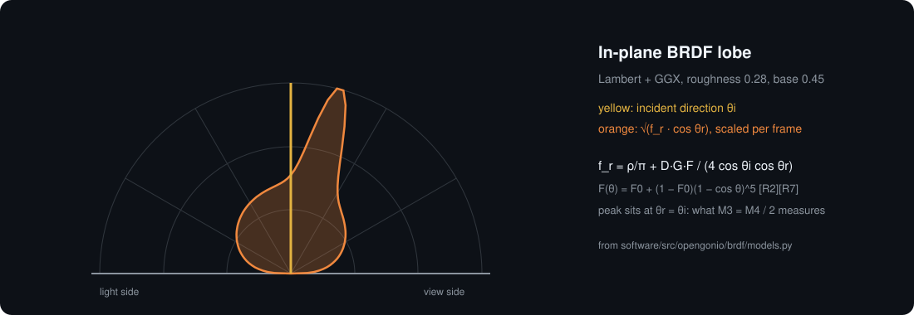

# 06 · Camera and light

$93.46 · total so far $346.82 / $500

[Design](design/) · [3D files](3d/) · [Bill of materials](bom/)

## M17 · Camera sees the zero point

Sharp, fixed-exposure image centred on the sample. · ~2 wk

**M17.1 Mount**

- [ ] Order phases/06-camera-light/bom/bom.csv
- [ ] Camera at 350 mm, 16 mm lens, f/8 stop
- [ ] **Done:** Table centre at image centre ±0.5 mm.

**M17.2 Lock settings**

- [ ] Lock exposure, gain, white balance
- [ ] Two frames 1 min apart differ < 1 %
- [ ] **Done:** Stable images.

## M18 · Lamp on and safe

Light switches from the laptop and stays cool. · ~1 wk

**M18.1 Lamp**

- [ ] COB on heatsink, NLDD driver on E4 HE0
- [ ] opengonio light on / off
- [ ] machine.yaml: installed_phase 6
- [ ] **Done:** COB case ≤ 70 °C after 10 min.

## M19 · Mirror test

First real data proves the angles are right. · ~1 wk

**M19.1 Mirror**

- [ ] opengonio plan mirror --theta 20, 40, 60
- [ ] Record peak positions
- [ ] **Done:** Peak within 0.5° of M3 = M4/2.

## M20 · First reflectance curves

Two real materials measured. · ~1 wk

**M20.1 Paper and plastic**

- [ ] In-plane scan of matte paper and glossy plastic
- [ ] **Done:** Two curves saved; paper ≈ cos θr.

> **Safety:** Don't stare into the lamp.

[Sources](../../REFERENCES.md): R1 · G12 · T32 · V1 · V2 · V3 · V4 · V5 · V7 · V8 · V9 · N3 · N11 · N24 · N25 · N45 · N46 · N47 · H13 · H14 · H15 · H49 · K1 · K2 · K3 · K4 · K5 · K6 · L1 · L2 · L3 · L4 · L5 · L6 · L7
