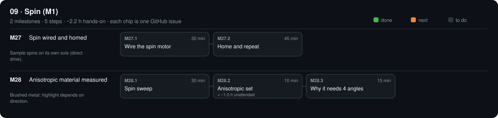

# 09 · Spin (M1)

$10.92 · total so far $423.90 / $450

[Design](design.md) · [Parts list](bom.csv) · [3D files](3d/)

## M27 · Spin wired and homed

Sample spins on its own axis (direct drive). · 0/2 steps done · ~1.2 h hands-on · ~1 wk

### M27.1 Wire the spin motor

**Time** 30 min · **Needs** CTL-11 cable · SPN-04 endstop · TBL-07b flag · CTL-06 leads · jumpers

#### Do

1. Spin motor cable into the E4 E0 socket (route it along the yoke arm with slack for ±90° tilt and ±180° table).
2. Flag on the platter rim (2 × M3 × 8), endstop on the cradle.
3. Endstop lead to TH0 (2-pin: signal + ground, no supply): S and G from TH0 via a 2-pin XH lead; the module's V from Pico 3V3 OUT (pin 36) via a lead whose XH housing slides over Pico pins 36–37 with only pin 36 populated. Pico GND is already tied to the E4 (M09.2 ground jumper).

#### Verify

- [ ] Platter turns 360° by hand with the motor unpowered; face runout < 0.3 mm at 40 mm radius.
- [ ] `?` shows `Pn:A` with the flag in the slot.

#### If a check fails

- No `Pn:A`: module V missing (3V3 lead) or the Pico not powered.

#### Record

Tick the boxes; `make done id=M27.1`.

### M27.2 Home and repeat

**Time** 45 min · **Needs** laser + mirror

#### Do

1. `installed_phase: 9`; `opengonio home`.
2. Mirror on the platter: `opengonio repeat M1 --at 0 --away 90 --n 20`.

#### Verify

- [ ] `"pass": true`.

#### Record

JSON in phases/09-spin/design.md → Results; commit.

## M28 · Anisotropic material measured

Brushed metal: highlight depends on direction. · 0/3 steps done · ~55 min hands-on · ~1 wk

### M28.1 Spin sweep

**Time** 30 min · **Needs** brushed aluminium swatch · tape arrow on the brushing direction

#### Do

1. Clamp the swatch, arrow at M1 = 0.
2. `opengonio capture spin --theta 30 --step 15 --out data/spin_brushed`
3. `opengonio curve data/spin_brushed`

#### Verify

- [ ] `centre_mean` max ÷ min ≥ 2 across M1 (curve.csv).
- [ ] Brightest when the arrow is vertical, i.e. grooves perpendicular to the light–camera plane (note that M1).

#### If a check fails

- < 2×: swatch not brushed enough, or polished; try a different piece.

#### Record

Max/min ratio and brightest M1 in phases/09-spin/design.md → Results.

### M28.2 Anisotropic set

**Time** 10 min (+ ~1.5 h unattended) · **Needs** same swatch

#### Do

1. `opengonio capture anisotropic --step 15 --phi-step 30 --out data/aniso_brushed`
2. `opengonio verify data/aniso_brushed`

#### Verify

- [ ] PASS, or WARN with only `saturated` ≤ 5 % of shots.

#### Record

Tick the boxes; `make done id=M28.2`.

### M28.3 Why it needs 4 angles

**Time** 15 min · **Needs** M28.2 · M26.3 plastic fit

#### Do

1. `opengonio curve data/aniso_brushed && opengonio fit data/aniso_brushed`

#### Verify

- [ ] `rms_pct_of_peak` for brushed ≥ 2 × the plastic's (an isotropic model can't fit it).

#### Record

Both RMS values in design.md; commit.

[Sources](../../REFERENCES.md): G5 · G9 · G11 · G14 · G16 · G18 · G27 · G40 · G43 · G44 · G49 · G50 · T4 · T15 · T26 · T34 · T37 · T41 · T42 · T44 · V9 · V48 · N8 · H3 · H37 · P43 · P48
