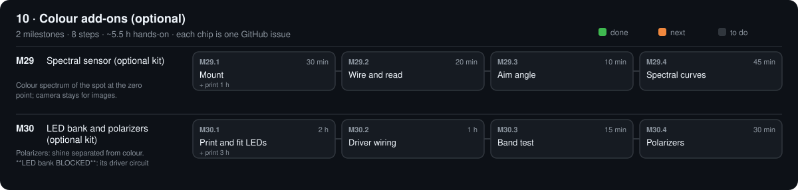

# 10 · Colour add-ons (optional)

[Design](design.md) · [Parts list](bom.csv) · [3D files](3d/)

## M29 · Spectral sensor (optional kit)

Colour spectrum of the spot at the zero point; camera stays for images. · 0/4 steps done · ~1.8 h hands-on · ~1 wk

### M29.1 Mount

**Time** 30 min (+ print 1 h) · **Needs** SPC-01 AS7341 · SPC-03 print · 2 × M2.5 screws

#### Do

1. Print `SPC-03a_spectral_tube.stl`; screw the AS7341 to it.
2. Clamp it on the camera pillar just above the camera (M5 × 10 into the z 181 pilot); aim at the zero point.

#### Verify

- [ ] Looking down the tube: the zero point is centred.

#### Record

Tick the boxes; `make done id=M29.1`.

### M29.2 Wire and read

**Time** 20 min · **Needs** SPC-02 cable

#### Do

1. SDA → Pico GP16, SCL → GP17, VIN → 3V3, GND → GND (same bus as the OLED).
2. `bash scripts/pico.sh`; `python -m serial.tools.miniterm /dev/ttyACM0 115200`; type `SPEC?`.

#### Verify

- [ ] Reply `SPEC` + 10 numbers; covering the tube drops all to < 5 % of uncovered.

#### If a check fails

- `ERR`: SDA/SCL swapped, or no 3V3.

#### Record

Wiring check in phases/10-color/design.md → Results.

### M29.3 Aim angle

**Time** 10 min · **Needs** ruler

#### Do

1. Measure the tube axis height h above the camera axis (mm).
2. Set `spectral.elevation_deg` = atan(h / 350) in `machine.yaml`.

#### Verify

- [ ] `make test` passes.

#### Record

h and the angle in design.md.

### M29.4 Spectral curves

**Time** 45 min · **Needs** PTFE · red paper · blue paper

#### Do

1. `opengonio capture inplane --step 10 --spectral --out data/ptfe_spec`; same for `red_spec`, `blue_spec`.
2. `opengonio curve data/ptfe_spec data/red_spec data/blue_spec`

#### Verify

- [ ] PTFE repeated twice: F1–F8 within 3 %.
- [ ] Red ÷ PTFE highest in F7–F8; blue ÷ PTFE highest in F2–F3.

#### Record

Ratios in design.md; commit.

## M30 · LED bank and polarizers (optional kit)

8 colour bands for images; shine separated from colour. Built it: set `lights.multispectral.built: true`; without it scans leave out the photometric set. · 0/4 steps done · ~3.8 h hands-on · ~2 wk

### M30.1 Print and fit LEDs

**Time** 2 h (+ print 3 h) · **Needs** MSK-01 LEDs · MSK-04 heatsink · MSK-06 prints

#### Do

1. Print `MSK-06a_led_ring.stl`, `MSK-06b_led_mast.stl`.
2. 7 pre-wired LED stars in slots 1–7 of the ring (slot 8 spare), thermal pad, wavelength written next to each.

#### Verify

- [ ] Ring on the mast at 40° elevation (angle gauge).

#### Record

Tick the boxes; `make done id=M30.1`.

### M30.2 Driver wiring

**Time** 1 h · **Needs** MSK-02 driver · MSK-03 ULN2803A

#### Do

1. ULN2803A into the breadboard. LED − leads → its outputs (lever connector to a cut jumper each); inputs ← Pico GP8–15 (jumpers); driver supply switched by `M62 P1`.

#### Verify

- [ ] Continuity: each GP pin → its ULN input; each output → one LED cathode.

#### Record

Tick the boxes; `make done id=M30.2`.

### M30.3 Band test

**Time** 15 min · **Needs** `installed_phase: 10` · `lights.multispectral.built: true`

#### Do

1. Hub: `BAND 0` … `BAND 7`, then `BAND OFF`.
2. `opengonio check-pose M4=60 M3=30`

#### Verify

- [ ] Exactly one LED per command.
- [ ] `"safe": true` with the mast fitted.

#### Record

Band → wavelength table in phases/10-color/design.md → Results.

### M30.4 Polarizers

**Time** 30 min · **Needs** MSK-05 film · mirror

#### Do

1. Film in the lamp slot; film disc on the lens.
2. Mirror at the specular pose; turn the lens disc to the darkest image, then 90°.

#### Verify

- [ ] Crossed ÷ parallel brightness ≤ 1/20.

#### Record

Both values in design.md; commit.

[Sources](../../REFERENCES.md): R1 · G17 · G28 · G37 · G41 · G42 · G45 · T30 · T52 · T53 · T54 · T55 · V9 · V49 · V50 · V51 · V52 · N9 · N13 · N15 · N16 · N17 · N18 · N19 · N20 · N21 · N22 · N23 · N27 · N37 · N38 · N39 · N40 · N41 · N42 · N43 · N44 · N47 · H10 · H40 · H42 · H59 · L4 · L7 · E8
