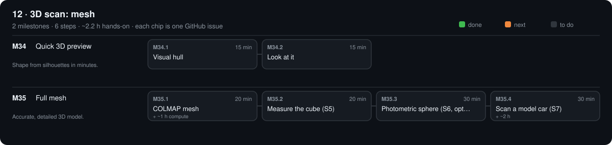

# 12 · 3D scan: mesh

[Design](design.md) · [Research](research.md) · [Tests](test.csv)

## M34 · Quick 3D preview

Shape from silhouettes in minutes. · 0/2 steps done · ~30 min hands-on · ~1 wk

### M34.1 Visual hull

**Time** 15 min · **Needs** scan_cube from M33

#### Do

1. `opengonio scan hull --out scan_cube --voxel 0.5`

#### Verify

- [ ] `size_mm` each 40 ± 1 (S4).

#### If a check fails

- Too big: background moved between passes → redo M33.1. Too small: threshold — dark faces vanish; light the cube more.

#### Record

S4 in `phases/12-scan-mesh/test.csv`.

### M34.2 Look at it

**Time** 15 min · **Needs** Blender

#### Do

1. Blender: File → Import → PLY → `scan_cube/hull.ply`.

#### Verify

- [ ] A cube with flat faces; no holes.

#### Record

Screenshot `phases/12-scan-mesh/hull.png`; commit.

## M35 · Full mesh

Accurate, detailed 3D model. · 0/4 steps done · ~1.7 h hands-on · ~1 wk

### M35.1 COLMAP mesh

**Time** 20 min (+ ~1 h compute) · **Needs** COLMAP (NVIDIA GPU) or Meshroom

#### Do

1. `cd scan_cube && bash run_colmap.sh` — or Meshroom on `images/` without a GPU.

#### Verify

- [ ] `dense/meshed-poisson.ply` exists and opens in Blender.

#### Record

Tick the boxes; `make done id=M35.1`.

### M35.2 Measure the cube (S5)

**Time** 20 min · **Needs** Blender measure tool

#### Do

1. Measure all 12 edges of the mesh.

#### Verify

- [ ] Every edge 40.0 ± 0.5 mm.

#### Record

S5 in `test.csv`.

### M35.3 Photometric sphere (S6, optional kit)

**Time** 30 min · **Needs** ping-pong ball, matte spray · LED bank (M30, optional: without it mark S6 n/a and tick this step)

#### Do

1. Ball on the riser: `opengonio scan run --out scan_ball`
2. `opengonio scan ps --out scan_ball --sphere`

#### Verify

- [ ] `sphere_median_normal_error_deg` ≤ 5.

#### If a check fails

- Large: wrong `gamma` (M22.1) or LED bank angle not 40° (M30.1).

#### Record

S6 in `test.csv`; `normals_st00.png` into `phases/12-scan-mesh/`.

### M35.4 Scan a model car (S7)

**Time** 30 min (+ ~2 h) · **Needs** 1:43 model car

#### Do

1. Background pass + scan + COLMAP as for the cube.
2. Import into Blender.

#### Verify

- [ ] Opens without repair (Mesh → Clean Up finds nothing).

#### Record

S7; commit.

[Sources](../../REFERENCES.md): R1 · R2 · S1 · S2 · S3 · S4 · S5 · S6 · S8 · S9 · S10 · S11 · S14 · S16 · S17 · S18 · V9 · V10 · V11 · V15 · V25 · V26 · V27 · V28 · V29 · V30 · V31 · V33 · V35 · V36 · V37 · V38 · V39 · V40 · V41 · V42 · V43 · V44 · V45 · V46 · V47
