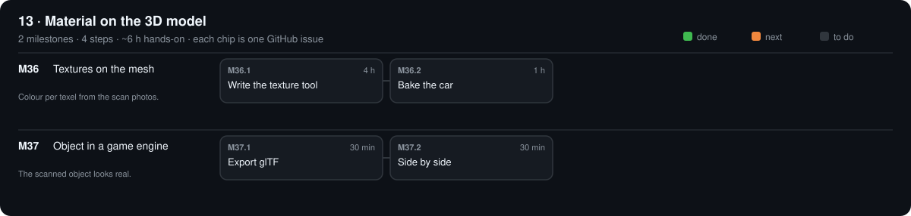

# 13 · Material on the 3D model

[Design](design.md)

## M36 · Textures on the mesh

Colour per texel from the scan photos. · 0/2 steps done · ~5 h hands-on · ~2 wk

### M36.1 Write the texture tool

**Time** 4 h · **Needs** Python · M35 mesh

#### Do

1. New file `software/src/opengonio/scan/texture.py`: `bake(mesh, scan_dir) -> albedo.png` — project each texel into every image where it faces the camera, average linear values (gamma from `calibration.yaml`).
2. Test `software/tests/test_texture.py`: synthetic sphere with a known albedo pattern (reuse `scan.demo`).

#### Verify

- [ ] `make test` passes; the test recovers albedo within 5 %.

#### Record

Commit the tool + test.

### M36.2 Bake the car

**Time** 1 h · **Needs** M35.4 car

#### Do

1. UV-unwrap (Blender Smart UV Project), export OBJ; bake with 10 % of images held out.

#### Verify

- [ ] Re-rendered held-out views vs photos: mean absolute error ≤ 10 %.

#### Record

Error in phases/13-object-material/design.md → Results; commit.

## M37 · Object in a game engine

The scanned object looks real. · 0/2 steps done · ~1 h hands-on · ~1 wk

### M37.1 Export glTF

**Time** 30 min · **Needs** Blender

#### Do

1. Mesh + albedo (+ roughness/metallic from M24 or M26 fits) → File → Export → glTF 2.0 (.glb).

#### Verify

- [ ] https://gltf.report shows 0 errors.

#### Record

Tick the boxes; `make done id=M37.1`.

### M37.2 Side by side

**Time** 30 min · **Needs** Unreal, Unity or Blender

#### Do

1. Import the .glb; light it like the photo (one light, same angle).

#### Verify

- [ ] Next to the photo: shape, colour and highlight match by eye.

#### Record

Screenshot `phases/13-object-material/engine.png`; commit.

[Sources](../../REFERENCES.md): S15 · G4 · T40 · T44 · T45 · T46 · T47 · T48 · T51 · V9 · V47 · V56 · V57 · V58 · N22 · N28 · N29
