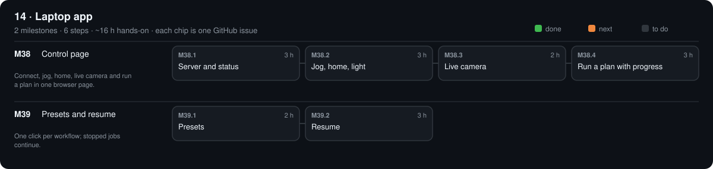

# 14 · Laptop app

[Design](design.md)

## M38 · Control page

Connect, jog, home, live camera and run a plan in one browser page. · 0/4 steps done · ~11 h hands-on · ~2 wk

### M38.1 Server and status

**Time** 3 h · **Needs** Python

#### Do

1. New `software/src/opengonio/web.py` (standard library `http.server`): `opengonio web` serves `http://localhost:8000`.
2. `GET /api/status` → `{state, pose, lights}`; works with `--sim`.
3. Test `software/tests/test_web.py` with the simulated machine.

#### Verify

- [ ] `opengonio --sim mirror web` then `curl localhost:8000/api/status` prints JSON with `pose`.
- [ ] `make test` passes.

#### Record

Commit.

### M38.2 Jog, home, light

**Time** 3 h · **Needs** M38.1

#### Do

1. `POST /api/home`, `/api/move {M4: 60}`, `/api/light {on: true}`; page buttons for each.
2. Unsafe or out-of-range moves return HTTP 400 with the `GantryError` text.

#### Verify

- [ ] With `--sim`: buttons move the pose shown by `/api/status`.
- [ ] `M4: 10` is refused with *keep-out*.

#### Record

Commit.

### M38.3 Live camera

**Time** 2 h · **Needs** M38.2

#### Do

1. `GET /api/frame.png` (simulated camera under `--sim`); page refreshes it every second.

#### Verify

- [ ] Image changes when M3 moves (`--sim mirror`: bright at the mirror pose).

#### Record

Commit.

### M38.4 Run a plan with progress

**Time** 3 h · **Needs** M38.3

#### Do

1. `POST /api/run {plan: "mirror", theta: 30}` runs `run_plan` in a thread; `GET /api/progress`; STOP button.

#### Verify

- [ ] The M19 mirror test runs start to finish from the page (sim, then hardware); `verify` on its folder PASS.

#### Record

Screenshot `phases/14-laptop-app/page.png`; commit.

## M39 · Presets and resume

One click per workflow; stopped jobs continue. · 0/2 steps done · ~5 h hands-on · ~1 wk

### M39.1 Presets

**Time** 2 h · **Needs** M38

#### Do

1. Buttons: *Mirror check*, *Swatch*, *Isotropic*, *Spin*, *3D scan* (same lists as the station jobs).

#### Verify

- [ ] Each preset runs with `--sim` and its folder verifies PASS.

#### Record

Commit.

### M39.2 Resume

**Time** 3 h · **Needs** M39.1

#### Do

1. `run_plan(..., resume=True)`: skip poses already in `manifest.json`; page button *Resume*.
2. Test: stop at 50 %, resume.

#### Verify

- [ ] Final shot count = plan length; no pose captured twice.
- [ ] `make test` passes.

#### Record

Commit.

[Sources](../../REFERENCES.md): G52 · T18 · T19 · T20 · T39 · T55 · V47 · V55 · H15 · H27 · H46 · H50
