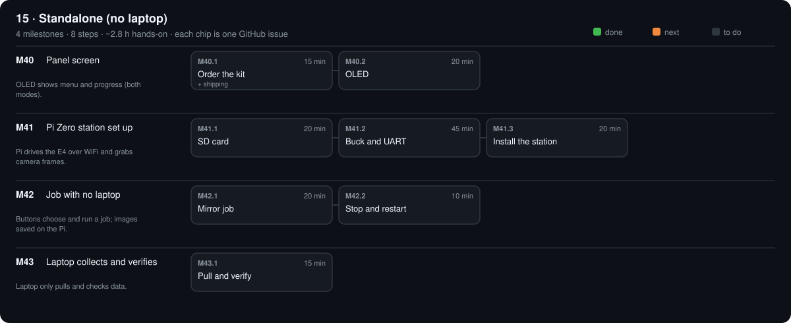

# 15 · Standalone (no laptop)

Optional kit $71.68 (not in the $630 total)

[Design](design.md) · [Parts list](bom.csv) · [3D files](3d/)

## M40 · Panel screen

OLED shows menu and progress (both modes). · 0/2 steps done · ~35 min hands-on · ~1 wk

### M40.1 Order the kit

**Time** 15 min (+ shipping) · **Needs** `PARTS.md` → 15 · Standalone

#### Do

1. Tick and order the STA parts you don't have; mark them `ordered`; print `STA-07a_pi_zero_mount.stl`.

#### Verify

- [ ] Stage 15 has no `agreed` or `suggested` parts left.

#### Record

Commit.

### M40.2 OLED

**Time** 20 min · **Needs** STA-05 OLED · STA-06 jumpers

#### Do

1. OLED SDA → GP16, SCL → GP17, VCC → 3V3, GND → GND.
2. `bash scripts/pico.sh`

#### Verify

- [ ] Screen shows `OpenGonio ready` and the button names.

#### If a check fails

- Blank: address not 0x3C — some boards are 0x3D; change it in `firmware/pico-hub/main.py`.

#### Record

Tick the boxes; `make done id=M40.2`.

## M41 · Pi Zero station set up

Pi drives the E4 over WiFi and grabs camera frames. · 0/3 steps done · ~1.4 h hands-on · ~1 wk

### M41.1 SD card

**Time** 20 min · **Needs** STA-01 Pi Zero 2 W · STA-02 microSD · Raspberry Pi Imager

#### Do

1. Imager: Pi OS Lite 64-bit; hostname `opengonio`; SSH on; your WiFi; your user.

#### Verify

- [ ] Pi boots; `ssh <you>@opengonio.local` logs in.

#### Record

Tick the boxes; `make done id=M41.1`.

### M41.2 Buck and UART

**Time** 45 min · **Needs** STA-03 buck · STA-04 OTG adapter · TLS-05 multimeter · cut jumpers

#### Do

1. Set the buck to 5.1 V **before** connecting the Pi (meter on its output).
2. Two cameras: a powered USB hub on the Pi's OTG port (STA-04) carries both.
3. Buck input: a thin pair under the jack's `+` / `−` screws in the power box (adapter unplugged first).
4. Wire buck output, UART and Pico power per `phases/15-standalone/design.md` (Pi GPIO14 → Pico GP1, GPIO15 ← GP0, GND, Pi 5V → Pico VSYS).

#### Verify

- [ ] Buck output 5.05–5.15 V under the Pi's load.

#### Record

Tick the boxes; `make done id=M41.2`.

### M41.3 Install the station

**Time** 20 min · **Needs** M41.2

#### Do

1. `bash scripts/station.sh <you>@opengonio.local`; then `ssh <you>@opengonio.local sudo reboot`.

#### Verify

- [ ] `ssh <you>@opengonio.local journalctl -u opengonio-station -n 20` shows `station ready`.
- [ ] OLED shows the first job name.

#### Record

Commit.

## M42 · Job with no laptop

Buttons choose and run a job; images saved on the Pi. · 0/2 steps done · ~30 min hands-on · ~1 wk

### M42.1 Mirror job

**Time** 20 min · **Needs** mirror on the table · laptop off

#### Do

1. NEXT until `Mirror check 30`; START.

#### Verify

- [ ] OLED shows `lamp warm-up`, then counts shots, then `done`.

#### Record

Tick the boxes; `make done id=M42.1`.

### M42.2 Stop and restart

**Time** 10 min · **Needs** M42.1

#### Do

1. START a job; STOP midway; START again.

#### Verify

- [ ] `~/opengonio-data/` has an aborted folder (`"aborted": "stopped"`) and a finished one (`"finished": true`).

#### Record

Tick the boxes; `make done id=M42.2`.

## M43 · Laptop collects and verifies

Laptop only pulls and checks data. · 0/1 steps done · ~15 min hands-on · ~1 wk

### M43.1 Pull and verify

**Time** 15 min · **Needs** M42 folders on the Pi

#### Do

1. `opengonio pull <you>@opengonio.local`
2. `opengonio verify data/*`; `opengonio curve data/<mirror job>`

#### Verify

- [ ] Mirror job: `"result": "PASS"`, `mirror_peak_error_deg` within ±0.5; chart peak on the orange line.

#### Record

Verify output in phases/15-standalone/design.md → Results; commit.

[Sources](../../REFERENCES.md): H51 · H52 · H53 · H55 · C7
