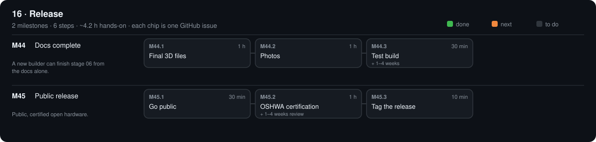

# 16 · Release

[Design](design.md)

## M44 · Docs complete

A new builder can finish stage 06 from the docs alone. · 0/3 steps done · ~2.5 h hands-on · ~2 wk

### M44.1 Final 3D files

**Time** 1 h · **Needs** Onshape

#### Do

1. Export final STEP + STL of every part you changed into its `3d/`; `make all`.

#### Verify

- [ ] `make check` four `OK`; `git status` clean after commit.

#### Record

Commit.

### M44.2 Photos

**Time** 1 h · **Needs** phone

#### Do

1. One photo per finished stage as `phases/NN/photo.jpg`; link it at the top of that `design.md`.

#### Verify

- [ ] Every stage 00–15 has a photo (`ls phases/*/photo.jpg | wc -l` ≥ 16).

#### Record

Commit.

### M44.3 Test build

**Time** 30 min (+ 1–4 weeks) · **Needs** a friend

#### Do

1. Give them the repo link; they build stages 00–06 using only the README and issues.

#### Verify

- [ ] They finish without asking you anything.

#### If a check fails

- Each question they ask = a missing line: add it to that step in `.github/phases.yml`.

#### Record

Their notes in phases/16-release/design.md → Results; commit.

## M45 · Public release

Public, certified open hardware. · 0/3 steps done · ~1.7 h hands-on · ~1 wk

### M45.1 Go public

**Time** 30 min · **Needs** `gh` logged in

#### Do

1. Check `LICENSE` and `LICENSES/`; `gh repo edit --visibility public`; make the Onshape document public.

#### Verify

- [ ] Repo page opens in a private browser window.

#### Record

Tick the boxes; `make done id=M45.1`.

### M45.2 OSHWA certification

**Time** 1 h (+ 1–4 weeks review) · **Needs** certification.oshwa.org account

#### Do

1. Apply with the repo link, licences (CERN-OHL-S-2.0, GPL-3.0-or-later, CC BY-SA 4.0).

#### Verify

- [ ] OSHWA UID issued.

#### Record

UID in the README title line; commit.

### M45.3 Tag the release

**Time** 10 min · **Needs** clean `git status`

#### Do

1. `make release s=16`

#### Verify

- [ ] GitHub → Releases shows `v0.16` with the 3D zip.

[Sources](../../REFERENCES.md): T50 · T51 · N50 · H31 · H32 · H33 · H34 · H35 · H36 · H45
