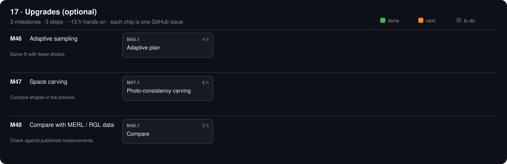

# 17 · Upgrades (optional)

[Design](design.md)

## M46 · Adaptive sampling

Same fit with fewer photos. · 0/1 steps done · ~4 h hands-on

### M46.1 Adaptive plan

**Time** 4 h · **Needs** Python · simulator

#### Do

1. New `software/src/opengonio/plans/adaptive.py`: start at a 30° isotropic grid; add poses between neighbours whose `brdf_per_sr` differ > 20 % [R15]; repeat until none.
2. Test with `--sim plastic`: compare with the 15° full grid.

#### Verify

- [ ] Fit within 2 % of the full-grid fit with ≥ 3 × fewer shots; `make test` passes.

#### Record

Shot counts + fits in phases/17-upgrades/design.md → Results.

## M47 · Space carving

Concave shapes in the preview. · 0/1 steps done · ~6 h hands-on

### M47.1 Photo-consistency carving

**Time** 6 h · **Needs** Python · M34 hull

#### Do

1. Extend `scan/carve.py`: after the hull, remove surface voxels whose colour disagrees across the views that see them [S7].

#### Verify

- [ ] A printed bowl: concave depth recovered within 2 mm (S4-style test in `make test`).

#### Record

Result in design.md.

## M48 · Compare with MERL / RGL data

Check against published measurements. · 0/1 steps done · ~3 h hands-on

### M48.1 Compare

**Time** 3 h · **Needs** a material that exists in MERL or RGL [R13][R16]

#### Do

1. Measure it (`capture isotropic`); `opengonio fit`.
2. Fit the published data with the same model (`opengonio.fit.fit`).

#### Verify

- [ ] Fitted roughness within 20 % of the published fit.

#### Record

Both fits + a plot in `phases/17-upgrades/`.

[Sources](../../REFERENCES.md): R15 · G11 · G13 · G15 · G31 · G32 · G46 · G47 · G48 · G51 · T3 · T6 · T7 · T16 · T18 · T23 · T24 · T27 · T28 · T29 · T33 · V6 · V32 · V34 · N5 · N11 · N39 · H12
